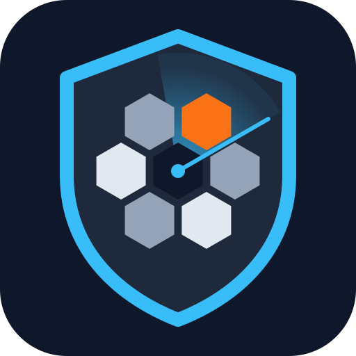

<p align="center"></p>

# Tephra

[tephrasec.tech](https://tephrasec.tech) · [Docs](https://tephrasec.tech/docs/) · [Rules](https://tephrasec.tech/rules/) · [Results](https://tephrasec.tech/results/)

A runtime threat-detection sensor for Kubernetes nodes. eBPF programs observe
process, file, network and privilege activity in the kernel; a Go agent
(`tephrad`) attributes each event to a pod and evaluates detection rules; alerts
land in Grafana. A scripted attack harness shows what it detects and what it
misses.

The full design is in [docs/design.md](docs/design.md).

> **Lab use only.** The attack scenarios in this repository are meant for the
> dev VM or a throwaway cluster that you own. Do not run them anywhere else.

## Status

Milestones follow section 10 of the design.

| Milestone | State |
|---|---|
| M0 Skeleton and dev environment | Done |
| M1 Process events | Done |
| M2 Process tree and pod attribution | Done |
| M3 Network and file events | Done |
| M4 Rule engine | Done |
| M5 Backend | Done |
| M6 Packaging | Done |
| M7 Harness and first coverage report | Done |
| M8 Remaining hooks | Done |
| After M8: refused opens, deletes and renames, runtime by file identity | Done |
| M9 Evasion work | Done: 8 scenarios, results in [docs/evasion.md](docs/evasion.md) |
| M10 Benchmarks | Done: the sensor's cost, in [docs/benchmarks.md](docs/benchmarks.md) |
| M12 Enforcement | Done; kernel tests pass on 5.15, 6.8 and 7.0 |
| M13 Correlation rules | Done; kernel tests pass on 5.15, 6.8 and 7.0 |
| M14 Closing evasion classes | In progress: fixes by attack class done; re-run on 5.15 measured ([docs/runs](docs/runs/2026-11-22-5.15/)), 7.0 to do |

What works today: the agent watches process starts and exits, connections
(IPv4, IPv6 and Unix sockets), opens of watched files, opens of those files
that the kernel refused, watched files being deleted, renamed, replaced or
linked, ptrace attach, credential changes, mounts, namespace switches, kernel
module loads, BPF program loads and memfd creation on its node. It attributes
each event to a pod, evaluates the 36 detection rules in [rules/](rules/), and writes events
and alerts as JSON lines on stdout. A collector forwards both to Loki, and a
Grafana dashboard shows the alerts and the sensor's own health.

The agent does not run privileged. It holds four capabilities (BPF, PERFMON,
SYS_PTRACE, SYS_RESOURCE), drops the rest, and has a read-only root
filesystem.

Rules that have to let the container runtime through (runc re-executing
itself, mounting a container's filesystem, loading cgroup BPF programs) know
it by the device and inode of the node's own runtime binaries, not by a path
or a command line, which a process in a container could copy.

[docs/coverage.md](docs/coverage.md) is the evidence: 22 attack techniques
run for real in the lab cluster, each with the rule that caught it, and a
30-minute run of ordinary workloads listing every alert that fired.

Two rules correlate events: a file fetched into a container and then
executed (R025), and a service account token read followed by a connection
to the Kubernetes API (R026), each within 60 seconds in the same pod.

Six rules can also block, off by default (see Enforcement below).

[docs/evasion.md](docs/evasion.md) is the other side: eight attempts to get
past the sensor, with what was predicted and what was measured, and a
write-up per finding in [docs/evasions/](docs/evasions/). Three get past it
today: a renamed shell (E01), a session inside an interpreter (E02), and
acting while the agent is killed (E07).

[docs/benchmarks.md](docs/benchmarks.md) measures the cost against no
sensor: four workloads, Tephra in three modes, five runs each on one EC2
instance; [docs/benchmarks-5.15.md](docs/benchmarks-5.15.md) is the run after
the M14 fixes, on 5.15. With alerts only, an exec-heavy loop loses 14% of
throughput and a compile 4%. The network workload is where Tephra is weakest:
every connection is an event the agent processes, so it costs 22% of request
throughput and about 70% of a CPU.

Not built yet: the EKS demo.

An alert, as `kubectl logs` shows it: the event that matched, with the rule
in front. This one is a bind shell started with `nc -l -p 4445 -e /bin/sh` in
a test pod; the shell's parent is the container's first process because the
process that started it had already exited.

```json
{
  "ts": "2026-11-11T19:49:26.482869Z", "type": "exec", "node": "tephra-worker",
  "rule": {"id": "R001", "title": "Shell with a network socket as stdin and stdout", "level": "high", "tags": ["attack.execution", "attack.t1059.004"]},
  "process": {
    "pid": 15643, "start_time_ns": 1930144414492,
    "Image": "/bin/sh", "CommandLine": "/bin/sh", "User": "root", "uid": 0, "gid": 0, "cgroup_id": 51745,
    "stdin_is_socket": true, "stdout_is_socket": true, "unlinked": false, "setuid": false, "argv_truncated": false,
    "inode": 812090, "dev": 355, "cap_effective": 2818844155, "env_truncated": false
  },
  "parent": {"pid": 1147, "Image": "/bin/httpd", "CommandLine": "/bin/httpd -f -p 8080 -h /tmp"},
  "ancestors": ["/bin/httpd", "/usr/local/bin/containerd-shim-runc-v2", "/usr/lib/systemd/systemd"],
  "container": {"id": "6a47c327a3cec33a154dc6f851804207ac257115f9bee65412cf1be9e0496f12", "name": "root", "image": "docker.io/library/busybox:1.37"},
  "k8s": {"namespace": "tephra-test", "pod": "probe", "labels": {"app": "probe"}}
}
```

Connection events add a `network` object (direction, family, protocol,
`SourceIp`, `SourcePort`, `DestinationIp`, `DestinationPort`, or `unix_path`);
file events add a `file` object (path, flags, `write`, `truncate`, `target`
when a file was recognised through a hard link, `op` on a file_change and
`error` on a file_denied). A process outside
every pod has `"k8s": {"namespace": "host"}` and no `container`. The agent's
own log goes to stderr; its lines have `level` and `msg` instead of `type`.

Counters per hook (seen, filtered, emitted, dropped), per rule, and for the
export queue are on `/metrics`, port 9090 of each agent pod.

## Rules

A rule is a YAML file: one event type, named blocks of field tests, and a
condition that combines the blocks, or a `sequence:` of two to four such
steps in one process tree or pod within a time window. [rules/](rules/) holds
R001 to R030 and R032 to R037; section 6 of the design describes the schema. Rules
can name what a binary is by its content (`process.identity`: shell,
interpreter, download_tool) and whether it changed after its container
started (`process.exe_modified`), not only its path.

```sh
bin/tephrad rules validate rules/                 # check every rule, errors carry file and line
bin/tephrad rules test rules/ events.jsonl        # run rules over recorded events, print the alerts
```

`events.jsonl` can be `kubectl logs` output of an agent. Each rule has
recorded events it must and must not fire on in `rules/testdata/`; `make test`
checks them.

File rules decide what the kernel reports. Only opens of files that some rule
names by exact path, by path prefix or by file name leave the kernel, and a
file rule that cannot be turned into such a filter is refused when it is
loaded.

The agent re-reads its configuration and rules on SIGHUP. If either is
invalid it keeps running on what it had and logs why.

## Enforcement

Rules with `action: block` (R003, R007, R011, R015, R016, R017) can also
refuse what they detect, in the kernel, before it happens: running a file
with no name on disk, writing to `/etc/ld.so.preload`, `release_agent` or
`core_pattern`, ptrace attach, kernel module loads, and mounts. It needs a
kernel with BPF LSM active (`bpf` in `/sys/kernel/security/lsm`); elsewhere
the agent says so and only detects.

```yaml
agent:
  enforcement:
    enabled: true     # off by default
    dryRun: true      # report what would be refused; refuse nothing
```

Only pods labelled `tephrasec.tech/enforce=true` are refused anything, never
pods in kube-system or the agent's namespace, never host processes, and
never the container runtime. Refusals are pinned under `/sys/fs/bpf/tephra`
and stay in force while the agent restarts. To turn all of it off at once:

```sh
kubectl -n tephra exec <agent pod> -- /tephrad enforce off
```

`harness run --enforce dry-run|on` runs the six blockable scenarios in
labelled pods and checks the refusal; `harness fp --enforce on` checks that
ordinary workloads are refused nothing. Section 9 of the design has the
details.

## Stopping and removing Tephra

Anything done through Kubernetes raises no alert: `kubectl rollout restart`,
`helm upgrade`, deleting an agent pod, draining a node, `helm uninstall`. Uninstall
leaves no programs or pins in the kernel. The agent recognises these stops
because the kernel shows the container runtime sent the signal.

Any other stop leaves a record. A signal sent to the agent by anything else
(a `kill` from a pod or from a shell on the node) is R030, critical, and any
process asking to attach to the agent or touch its memory is R033, critical. An agent
that is killed, crashes or is frozen leaves its programs pinned and recording
under `/sys/fs/bpf/tephra/detect`, and the next agent reads what happened in
between; the collector reports the gap as R031. To remove what such an agent
left pinned:

```sh
kubectl -n tephra exec <agent pod> -- /tephrad detect off
```

Someone with root on the node, or a cluster administrator, can still stop
Tephra; no sensor can prevent its own administrator. What they cannot do is
stop it without a trace: R031 notices a node that goes quiet, and the
Kubernetes audit log records the API actions. Section 7 of the design has the
full table.

## Attack harness

> **Lab use only.** The harness runs real attack techniques: it opens a
> reverse shell, mounts the node's disk, loads a kernel module. It refuses to
> start unless every node of the cluster is labelled `tephrasec.tech/lab=true`,
> which the kind cluster of this repository is. There is no flag to override
> that.

```sh
bin/harness list                     # the scenarios and the rules each must trigger
bin/harness run A01 A04              # run two scenarios
make coverage                        # run all of them, rewrite docs/coverage.md
make false-positives                 # 30 minutes of ordinary workloads, list every alert
make evasions                        # the evasion scenarios, rewrite docs/evasion.md
```

Each scenario is a directory under [attacks/](attacks/): the victim workload
(`target.yaml`), the technique (`run.sh`, executed inside the target pod),
and what must fire (`scenario.yaml`). A run creates a fresh namespace,
applies the workload, runs the technique, asks Loki through Grafana for the
alerts of that namespace, and deletes the namespace. The verdict per rule is
detected, partial (the alert fired but names the wrong pod or no container)
or missed.

`make coverage` also saves the event behind every detection to
`rules/testdata/<rule>.live.jsonl`, and the rule tests check that each rule
still fires on it.

## Benchmarks

```sh
bench/matrix.sh 5                    # every configuration by every workload, five runs each
bench/supervise.sh 5                 # the same unattended: retries, summary, then powers off
```

Lab cluster only. Each cell is `bench/run.sh <configuration> <workload>
<run>` and writes `bench/raw/<configuration>/<workload>/<run>.json`; cells
already there are skipped, so an interrupted matrix resumes. `go run ./cmd/bench bench/raw docs/benchmarks.md`
rebuilds the report from the raw results.

## Connection cost

A pod that makes or takes many connections can cost the agent most of a
CPU: by default every connect and accept is an event. Two options cut that;
both are off until you turn them on, and `helm install` recommends both:

```sh
helm upgrade tephra deploy/helm/tephra -n tephra --reuse-values \
  --set agent.quietConnections=true --set agent.ringWakeup.bytes=65536
```

- **`quietConnections`**: the kernel skips the connections of a process
  that no loaded rule can fire on (a web server, a client that is not an
  interpreter). Connects to a port a rule names and to the Kubernetes API are
  always reported, and a process that runs another program, changes user or
  moves cgroup is reported again. With raw events exported, the skipped
  connections are kept as `connection_summary` records: one per process and
  destination every 10 seconds, with the count and the first and last time.
- **`ringWakeup.bytes`**: the kernel wakes the agent once 64 KiB of records
  wait instead of for each one; the agent also reads every 10 ms.

Measured on a 5.15 node, 200,000 requests through one client (3 runs,
[build log](docs/design.md#12-build-log), item 4):

| Every event exported | Network | Loopback | Agent CPU |
|---|---|---|---|
| Both off (default) | −21.7% | −15.1% | 60% |
| Both on | −3.1% | −5.0% | 2% |

In the lab's attack, evasion and false-positive runs they caused no missed
detection and no new alert. What you give up with them on:

- the time of each connection, and the client's own port: a summary keeps
  the count and the first and last time per destination;
- alerts can arrive up to 10 ms later;
- a process that exits while no agent runs, in a container gone before the
  next agent starts, has its counted connections reported under namespace
  `unknown`, as the ring buffer's backlog is.

The full account, including why detection does not change, is in
[section 2 of the design](docs/design.md#what-the-connection-cost-options-change).

## Backend

The chart installs a collector, a single-binary Loki and Grafana next to the
agents. Open the dashboard with:

```sh
kubectl -n tephra port-forward svc/tephra-grafana 3000:3000
kubectl -n tephra get secret tephra-grafana -o jsonpath='{.data.admin-password}' | base64 -d
```

The user is `admin`; the password is generated at install time. The bundled
Loki keeps its data in an `emptyDir` unless `loki.persistence.enabled` is set,
and is meant for a lab or a demo. To use your own Loki, set
`loki.enabled=false` and `collector.lokiUrl`.

An agent keeps a record until the collector confirms that Loki stored it, so
a collector restart loses nothing that was queued. The queue is bounded
(8,192 records by default); when it overflows, raw events are dropped before
alerts, and when it holds only alerts the oldest of the lowest level goes
first, so a flood cannot push out a critical alert. Every drop is counted in
`tephra_export_dropped_total`, and alerts by level in
`tephra_export_dropped_alerts_total`. Before the queue, repeats of
an alert within 10 seconds are sent as one summary with a count; the first
one is always sent at once.

## Requirements

The sensor needs an x86-64 kernel, 5.15 or newer, with BTF
(`/sys/kernel/btf/vmlinux`) and cgroup v2.

Building on the host needs Go 1.27, clang, llvm and the libbpf headers.

The dev VM needs QEMU/KVM and libvirt. On Arch:

```sh
sudo pacman -S --needed libvirt virt-install qemu-img passt libisoburn bpf
```

Docker, kind, kubectl and helm are installed inside the VM, not on the host.

## Quick start

```sh
make vm-up      # create and provision the VM (first run downloads an Ubuntu cloud image)
make vm-sync    # copy the working tree into the VM
make vm-ssh     # shell in the VM, in ~/tephra

# inside the VM
make dev        # kind cluster, image build, helm install, acceptance tests
```

`make dev` ends by running the acceptance test of every finished milestone
(`hack/accept-m*.sh`), each printing what it checked and a verdict:

```
PASS: program attached on 3/3 nodes
ok: one exec event within 1s: {"node":"tephra-worker","Image":"/bin/ls","CommandLine":"ls -la /tmp","uid":1000}
ok: after 10,000 execs (+10068 seen on tephra-worker), emitted + dropped + filtered == seen on every agent
PASS: M1
ok: pod event attributed: ...
ok: host process labelled host, reported once: ...
ok: after agent restart, a child of a pre-existing process resolves: ...
PASS: M2
...
PASS: M3
...
PASS: M4
...
PASS: M5
...
PASS: M6
```

`make accept` reruns only the tests against the cluster that is already up.

The VM runs in the unprivileged libvirt session and is reachable only through
`127.0.0.1:2222`. `make vm-down` stops it and `make vm-destroy` deletes it with
its disk.

To test on the 5.15 kernel floor, create a second VM from Ubuntu 22.04 with
the same script and run `make dev` inside it:

```sh
VM_NAME=tephra-floor SSH_PORT=2223 UBUNTU_RELEASE=jammy UBUNTU_VERSION=22.04 deploy/vm/vm.sh up
```

Pass the same variables to `vm.sh sync`, `ssh` and `destroy`.

The VM takes its DNS servers from the laptop when it starts. If the laptop
moves to another network while the VM is running, image pulls inside it fail;
`make vm-down && make vm-up` fixes that.

## Releases

Pushing a tag `vX.Y.Z` (or `vX.Y.Z-rc.N` for a release candidate) that matches the chart's `appVersion` runs [.github/workflows/release.yaml](.github/workflows/release.yaml),
which builds the two images, pushes them to `ghcr.io/tephrasec`, signs them
with cosign (keyless, bound to that workflow) and pushes the chart with both
images pinned by digest, and creates the GitHub release from
`docs/releases/<tag>.md` (marked as a pre-release for a release candidate). The kind setup builds and loads its own images.

From v0.1.0 the project lives in the `tephrasec` organisation: the Go module is
`github.com/tephrasec/tephra`, the images are `ghcr.io/tephrasec/*`, and the
enforcement label is `tephrasec.tech/enforce`. The old label `tephra.dev/enforce`
no longer turns anything on.

## Other targets

```sh
make build      # compile the BPF programs, build bin/tephrad, bin/collector and bin/harness
make test       # unit tests, unprivileged
make rules-validate  # check the shipped rules
make proto      # regenerate the Go code of the agent-to-collector API
make test-root  # load the programs into the running kernel and check real events (use the VM)
make lint       # go vet, golangci-lint, clang-format, shellcheck
make vmlinux    # regenerate bpf/vmlinux.h from the running kernel
make help
```

## Layout

```
api/                 protobuf definition of the agent-to-collector API
bpf/                 eBPF programs (C, CO-RE)
cmd/tephrad/         agent entrypoint, rules subcommands
cmd/collector/       gRPC -> Loki
cmd/harness/         attack runner and coverage report
cmd/bench/           benchmark report from bench/raw
attacks/             one directory per attack scenario
evasions/            one directory per evasion scenario
bench/               benchmark scripts, workloads and raw results
internal/loader/     bpf2go bindings, attach, kernel feature probes
internal/events/     Go mirrors of the kernel structs, decoder
internal/proctree/   process cache and /proc seeding
internal/k8s/        cgroup ID -> container -> pod
internal/enrich/     ancestry, user and pod attribution per event
internal/filter/     what the kernel is told to report
internal/inodewatch/ watched files by device and inode, per root filesystem
internal/runtimeid/  the node's container runtime binaries, by device and inode
internal/rules/      rule parser, compiler and matcher
internal/config/     configuration file
internal/export/     wire format, JSON lines on stdout, gRPC client
internal/collector/  stream handling, batching, Loki push
internal/harness/    scenario runner, verdicts, report
rules/               shipped detection rules and their recorded events
deploy/docker/       image builds
deploy/helm/tephra/  Helm chart
deploy/kind/         lab cluster definition
deploy/vm/           dev VM definition
deploy/aws/          lab on EC2 (lab.sh)
deploy/terraform/    lab instance on EC2
hack/                acceptance tests, one script per milestone
docs/                design, coverage, evasion and benchmark reports
```

## Licence

The eBPF programs under `bpf/` are GPL-2.0. Everything else is Apache-2.0. Each
source file carries an SPDX identifier, and the licence texts are in
[LICENSES/](LICENSES/).
