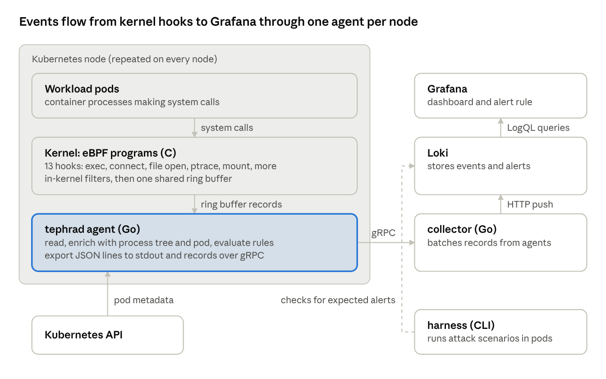

# Tephra: Kubernetes Runtime Threat-Detection Sensor — Engineering Design

Nov 10, 2026 · @nk

## 1. Summary and locked decisions

The project is a Linux runtime security sensor for Kubernetes nodes: eBPF programs observe process, file, network and privilege activity in the kernel, a Go agent attributes each event to a pod and evaluates detection rules, and alerts land in Grafana. A scripted attack harness proves what it detects and what it misses.

It runs as one privileged DaemonSet pod per node. Version 1 detects only. Version 2 adds in-kernel blocking through LSM hooks.

This document is the build spec. Every milestone in section 10 has an acceptance test, and nothing outside this document is in scope without a change here first.

| # | Decision | Choice | Reason |
|---|---|---|---|
| 1 | Kernel side | C, libbpf-style, CO-RE | Largest body of reference code; same approach as Tetragon and Cilium |
| 2 | Userspace agent | Go with cilium/ebpf and bpf2go | Existing Go experience; first-class Kubernetes client libraries |
| 3 | v1 scope | Detect only; blocking is v2 | A showable result earlier; enforcement is designed in section 9 but built last |
| 4 | Dev and test environment | Local VM running a kind cluster; EKS only for the final demo | Attack tests never touch the laptop host; AWS spend stays at a few dollars |
| 5 | Build mode | Spec-driven from this document; design owned by Naved | The doc carries hook lists, struct layouts, map definitions and interfaces |
| 6 | Event pipeline | JSON lines plus gRPC to a Go collector, stored in Loki, viewed in Grafana | No custom UI; a stack security teams already operate |
| 7 | Rule format | Own YAML schema with Sigma-style field names and ATT&CK tags | Full control over which predicates are pushed into the kernel |
| 8 | Repository and licence | Public; kernel programs GPL-2.0, agent and everything else Apache-2.0 | Recruiters can read it; most BPF helpers require a GPL-compatible program licence |
| 9 | Schedule | No dates; milestones ordered by dependency | Chosen explicitly |

The project is named Tephra. The repo and Helm chart are tephra, and the agent binary is tephrad. Where this document says "the sensor", it means Tephra.

## 2. Goals, non-goals and threat model

### Goals

- Detect the post-exploitation techniques listed in section 6 on a Kubernetes node, with each alert naming the pod, container, image and process ancestry.
- Prove coverage with a repeatable attack harness that produces a detected / missed table mapped to MITRE ATT&CK.
- Measure overhead against Falco and Tetragon on the same workloads and publish the numbers, including the unfavourable ones.
- Run on any x86-64 kernel 5.15 or newer with BTF, without compiling on the node.
- In v2, block a small set of high-confidence actions synchronously in the kernel.

### Non-goals

- Windows, macOS or arm64 support.
- Kernels older than 5.15 or without BTF. No kernel-module fallback.
- A custom web UI, multi-tenant backend or long-term storage design.
- Malware scanning, file hashing against threat feeds, or network payload inspection.
- Detecting attacks that happen entirely inside the Kubernetes API (RBAC abuse, malicious admission). The sensor sees nodes, not the API server audit log.
- Being a product. No installer, licensing server or support matrix.

### Threat model

The attacker has code execution inside a container, through an application vulnerability or a malicious image, and is trying to do one of five things: get an interactive shell, steal credentials, persist, move to the host, or use the node's resources.

| Attacker position | In scope | Notes |
|---|---|---|
| Unprivileged process in a container | Yes | Primary case |
| Root in an unprivileged container | Yes | Primary case |
| Root in a privileged or hostPID container | Yes, detect the escape | The escape itself is the detection target |
| Root on the host | Partly | Can stop the sensor, detach its pinned programs or unmount bpffs. Not prevented: no sensor can stop its own administrator. What it leaves is a trail: R030 for a signal sent other than through Kubernetes, R031 when the node goes quiet, and the Kubernetes audit log for API actions |
| Cluster-admin, or anyone allowed to manage the tephra namespace | Partly | Can stop or remove Tephra the way an operator does, which raises nothing by design (section 7, "Operating Tephra"). The Kubernetes audit log is the record |
| Kernel code execution (malicious module, kernel exploit) | No | An attacker in the kernel can blind any eBPF sensor; only the module load is detectable |

### Trust boundaries

- Everything read from user memory at a syscall entry is attacker-controlled and can change after the sensor reads it. Section 9 covers why this matters for blocking.
- Kernel structures read at LSM hooks and scheduler tracepoints (task_struct, linux_binprm, struct file) are trusted.
- The agent trusts the kubelet and the container runtime on its own node, and nothing from inside workload containers.

## 3. Architecture

Four components run per cluster: eBPF programs and the agent on every node, and one collector feeding Loki and Grafana. Only the agent talks to the kernel, and only the collector talks to Loki.



Read it bottom-up on the left and bottom-up on the right: the kernel feeds the agent, the agent feeds the collector, and the dashed line is the harness checking Loki for the alerts its attacks should have produced.

### Components

| Component | Runs as | Language | Responsibility |
|---|---|---|---|
| eBPF programs | In the kernel, loaded by the agent | C | Capture events at hooks, apply in-kernel filters, write to the ring buffer |
| tephrad agent | DaemonSet pod, one per node | Go | Load programs, read events, build the process tree, attribute to pods, evaluate rules, export |
| collector | Deployment, 1 replica | Go | Receive gRPC streams from agents, batch, push to Loki |
| Loki + Grafana | Templates in the chart, each optional | — | Store events and alerts, dashboards, alert rules |
| harness | CLI run from the dev machine | Go + shell | Run attack scenarios, query Loki, write the coverage report |

### Path of one event

1. A process in a pod calls execve. The sched_process_exec tracepoint fires in the kernel.
2. The eBPF program checks the per-event-type enable flag and the in-kernel filters. If the event passes, it fills an exec_event and submits it to the ring buffer.
3. The agent's reader goroutine decodes the bytes into a Go struct and hands it to the enrichment stage.
4. Enrichment looks up the process in the process tree, and resolves its cgroup ID to container ID, pod, namespace and image.
5. The rule engine evaluates every rule subscribed to exec events. A match produces an alert that embeds the full event.
6. The exporter writes the event and any alert as JSON lines to stdout and streams them over gRPC to the collector.
7. The collector batches by label set and pushes to Loki. Grafana shows the alert within the dashboard refresh interval.

### Repository layout

```
tephra/
  bpf/                    # GPL-2.0
    vmlinux.h             # generated by bpftool, committed per arch
    common.h              # event header, shared maps, helper macros
    exec.bpf.c  net.bpf.c  file.bpf.c  priv.bpf.c  tamper.bpf.c
    tephra.bpf.c          # includes the others; compiled as one object
    lsm.bpf.c             # v2 enforcement
  cmd/
    tephrad/              # agent entrypoint
    collector/            # gRPC -> Loki
    harness/              # attack runner + coverage report
  hack/                   # acceptance-test scripts
  internal/
    loader/               # bpf2go output, attach, kernel feature probes
    events/               # Go mirrors of C structs, decoder
    proctree/             # process cache
    k8s/                  # cgroup -> container -> pod
    enrich/               # ancestry, user and pod attribution per event
    rules/                # YAML parser, compiler, evaluator
    filter/               # what the kernel is told to report
    inodewatch/           # watched files by device and inode
    config/               # configuration file
    export/               # stdout, gRPC client
    collector/            # stream handling, batching, Loki push
  api/                    # protobuf definitions
  rules/                  # shipped detection rules (YAML)
  attacks/                # one directory per scenario
  deploy/
    docker/               # image build files
    helm/tephra/          # DaemonSet, collector, RBAC, sub-charts
    kind/                 # lab cluster definition
    terraform/eks-demo/   # throwaway EKS cluster
    vm/                   # dev VM definition
  bench/                  # workloads and result parser
  docs/                   # this design, coverage report, evasion write-ups
  LICENSES/               # GPL-2.0 and Apache-2.0 texts, SPDX headers per file
```

### Interfaces between components

- Kernel to agent: one BPF_MAP_TYPE_RINGBUF carrying variable-length records that all start with the common header in section 4. Config flows the other way through BPF maps the agent writes.
- Agent to collector: a client-streaming gRPC call Export(stream Record) returns (Ack), where Record wraps either an event or an alert as protobuf. One stream carries one batch, and the Ack comes only after Loki has stored it. mTLS is out of scope for v1; the service is cluster-internal.
- Collector to Loki: HTTP push to /loki/api/v1/push.
- Agent to Kubernetes: a pod informer filtered to spec.nodeName == <this node>, read-only.

## 4. Kernel sensor

The kernel side is thirteen small programs that each attach to one hook, fill one event struct and submit it to a shared ring buffer. Hooks are chosen so that every field read comes from kernel memory, not from user pointers.

### Hook list

| Event type | Hook | Program type | What is read | Milestone |
|---|---|---|---|---|
| exec | sched_process_exec | tp_btf | Binary path, inode, argv from mm->arg_start, stdio fd types, creds | M1 |
| fork | sched_process_fork | tp_btf | Parent and child pid, start time | M1 |
| exit | sched_process_exit | tp_btf | Pid, exit code | M1 |
| connect | security_socket_connect | fentry | Family, destination address and port (or Unix socket path) from the kernel copy of sockaddr | M3 |
| accept | security_sock_graft (fallback: inet_csk_accept, fexit) | fentry | Local and peer address from the accepted struct sock | M3 |
| file_open | security_file_open | fentry | Path via bpf_d_path, open flags, inode and device | M3 |
| file_change | security_path_unlink, security_path_rename, security_path_link, security_path_symlink, vfs_truncate | fentry | The name removed, renamed, replaced or created as a link; its path rebuilt from the directory entries, across mount points | after M8 |
| file_denied | do_filp_open, or do_file_open on kernels that renamed it | fexit | Opens refused with EACCES, EPERM or EROFS: the name as passed, the open flags, and the working directory for a relative name | after M8 |
| ptrace | security_ptrace_access_check | fentry | Target pid, mode (only PTRACE_MODE_ATTACH is emitted) | M8 |
| memfd | __x64_sys_memfd_create | fentry | Flags only; the name pointer is not trusted | M8 |
| module_load | module_load | tp_btf | Module name | M8 |
| bpf_load | security_bpf | fentry | Command (only BPF_PROG_LOAD), program type, program name | M8 |
| cred_change | commit_creds | fentry | Old and new uid, euid, gid and effective capabilities; whether an exec made the change | M8 |
| mount | security_sb_mount | fentry | Filesystem type, flags, the last six components of the target path | M8 |
| setns | switch_task_namespaces | fentry | Which namespaces changed and the inode number of each namespace afterwards | M8 |
| signal | security_task_kill | fentry | Signals sent by a process to the agent: the sender (the header), the signal number, the agent's pid | M14 |

Reasons behind the less obvious choices:

- sched_process_exec instead of sys_enter_execve. The syscall-entry tracepoint fires before the kernel has resolved anything, so the path and argv are user pointers that can be rewritten by another thread. The scheduler tracepoint fires after the exec has succeeded and exposes struct linux_binprm.
- security_* functions with fentry in v1. They are the same call sites the LSM programs use in v2, so the v2 change is mostly a program-type switch plus a return value. fentry needs kernel 5.5 or newer on x86-64 and is cheaper than a kprobe.
- security_sock_graft for accept. It is entered in the accepting task once the connection is established, with the new socket as an argument. An exit hook on inet_csk_accept would miss the first connection of every server that was already waiting in accept() when the agent attached; it is kept only as a fallback.
- The return of do_filp_open for refused opens. security_file_open only runs once the permission checks have passed, so a refusal is invisible there. Every open ends in do_filp_open, whichever check said no. Refusals are rare, so the kernel sends all of them and the agent matches the name against the watches.
- The path hooks for file_change. Deleting a watched file, renaming another file onto its name or linking the name somewhere else never opens it. The security_path_* functions give the directory's mount as well as the entry, which the path needs; they exist on kernels built with CONFIG_SECURITY_PATH (AppArmor and Landlock select it). Without them the event type is reported as unavailable.
- security_task_kill for signals. It runs for every signal a process sends, and not for signals the kernel raises itself (a fault, a terminal's ^C). Only signals to the agent are kept, and not those the agent sends itself, which Go does constantly. The event is written before the signal is delivered, so a SIGKILL still leaves it in the ring buffer.
- commit_creds is not a stable interface. It is the one hook most likely to need a fallback; the loader treats attach failure here as a warning, not an error.

### Common event header

Every record starts with this header. The agent switches on type and uses size to decode the rest.

```
struct event_hdr {
    __u64 ts_boot_ns;      // bpf_ktime_get_boot_ns()
    __u64 start_time_ns;   // task->start_boottime: (pid, start_time) is the process key
    __u64 cgroup_id;       // bpf_get_current_cgroup_id(), cgroup v2
    __u32 type;            // enum event_type
    __u32 size;            // total record size in bytes
    __u32 pid;             // tgid in the node's pid namespace (the root one on a real node)
    __u32 tid;
    __u32 ppid;
    __u32 uid;
    __u32 gid;
    __u32 pid_ns;          // inode number of the pid namespace
    __u32 mnt_ns;          // inode number of the mount namespace
    __u32 flags;           // per-type flag bits
    __u32 net_ns;          // inode number of the network namespace (M14)
    __u32 _pad;
    char  comm[16];
};                         // 88 bytes
```

The ring buffer outlives its agent, so a record layout version (`events.LayoutVersion`) is pinned next to it, and an agent adopts a leftover buffer only if it was written in the layout it decodes.

### Event payloads

```
struct exec_event {
    struct event_hdr h;
    __u64 inode;
    __u32 dev;
    __u32 argv_len;        // bytes used in argv, NUL-separated
    __u64 cap_effective;
    __u32 env_len;         // 0, or 768 when any env slot is filled
    char  path[256];       // bprm->interp; bpf_d_path is not callable from this hook
    char  argv[1024];      // truncated; EXEC_F_ARGV_TRUNC set in h.flags
    char  env[768];        // one 256-byte NAME=value slot each for LD_PRELOAD,
                           // LD_AUDIT and LD_LIBRARY_PATH; sent only if one is set
};
// h.flags: EXEC_F_STDIN_SOCK, EXEC_F_STDOUT_SOCK, EXEC_F_UNLINKED (i_nlink == 0),
//          EXEC_F_SETUID, EXEC_F_ARGV_TRUNC, EXEC_F_ENV_TRUNC

struct net_event {         // connect and accept
    struct event_hdr h;
    __u16 family;          // AF_INET or AF_INET6
    __u16 lport;
    __u16 rport;
    __u16 proto;
    __u8  laddr[16];
    __u8  raddr[16];
};

struct file_event {
    struct event_hdr h;
    __u64 inode;
    __u32 dev;
    __u32 open_flags;
    __u32 watch_bits;      // value of the matching watch entry
    __u32 path_len;        // only this much of path is sent
    char  path[256];
};
// h.flags: which filter matched (FILE_F_BY_INODE, FILE_F_BY_NAME, FILE_F_BY_PATH),
//          FILE_F_NO_PATH, FILE_F_KERNEL_CREDS
```

A connect to an AF_UNIX socket is emitted as a separate unix_connect record: the header plus sun_path[108] from the kernel copy of the address. R010 matches on it.

The remaining payloads (ptrace, signal, memfd, module_load, bpf_load, cred_change, mount, setns) are small fixed structs in bpf/common.h; each is the header plus the fields named in the hook table.

The two socket flags on exec are the basis of reverse-shell detection: the program reads file descriptors 0 and 1 from task->files->fdt and checks whether each inode is a socket.

### BPF maps

| Map | Type | Key and value | Written by | Purpose |
|---|---|---|---|---|
| events | RINGBUF, 16 MiB default | — | Kernel | All events to userspace |
| scratch | PERCPU_ARRAY, 1 entry | index, largest event struct | Kernel | Build events that exceed the 512-byte BPF stack |
| cfg | ARRAY, 1 entry | index, struct tephra_cfg | Agent | Enabled event bitmask, agent tgid |
| stats | PERCPU_ARRAY | event type, {seen, filtered, emitted, dropped} | Kernel | Per-hook counters, exported as metrics |
| path_watch | LPM_TRIE | {prefixlen, path[128]}, watch bits | Agent | Path prefixes that file_open should emit; an exact path is stored with its terminating NUL |
| inode_watch | HASH | {inode, dev}, watch bits | Agent | Files watched by identity. An entry with inode 0 watches every file on its device: a Kubernetes credential volume, a tmpfs of its own (M14) |
| name_watch | HASH | name[32], watch bits | Agent | Files watched by their last path component, wherever they are |
| agent_tasks | HASH | kernel tgid, start time of the process | Agent | Skip the agent's own process. Keyed by process, not cgroup: a process moved into the agent's cgroup is still seen (E15). The start time is compared too, so a process that later gets a dead agent's pid number is not skipped |
| net_ignore_v4, net_ignore_v6 | LPM_TRIE | CIDR, 1 byte | Agent | Destinations never emitted. Empty by default: loopback is seen since M14 |

### In-kernel filtering

Filtering in the kernel is what keeps overhead low, because the expensive part of an event is copying it to userspace.

- Each program first checks its bit in cfg.enabled and returns if clear.
- It then skips the agent's own process, looked up in agent_tasks.
- file_open checks inode_watch (the file, then its whole device), then name_watch, then resolves the path into scratch and does one path_watch lookup. No match means no event. The watch bits say whether an entry reports reads, writes or both, so a rule about writes costs nothing for reads. This is the only way file monitoring is affordable; unfiltered opens are the highest-volume event on any node.
- connect and accept check the remote address against the ignore tries.
- Events are built in scratch and sent with bpf_ringbuf_output using the actual length, so a short argv does not consume 1.3 KiB of ring space. The cost is one extra copy compared with bpf_ringbuf_reserve.
- If the ring buffer is full, the program increments stats.dropped for its type and returns. Drops are never silent: the agent exports the counter and the coverage report prints it.

File watching also matches by identity. A second map, inode_watch (HASH, key {dev, inode}, value watch bits), is checked before path_watch, so a watched file opened through a hard link or an unexpected path is still emitted. The agent fills it by resolving each exact-file rule path to its inode: on the host at start-up, and inside each container when the container starts, through /proc/<pid>/root. Prefix rules for directories stay path-based. It also fills it with every service account token the pod specs name, whatever its path (M14): a token's volume is watched as a whole device, because the kubelet writes a new file at every rotation, and the agent matches each open on it against the token's name.

### Portability and kernel requirements

Programs are compiled once with CO-RE. vmlinux.h is generated with bpftool btf dump and field access goes through BPF_CORE_READ, so offsets are relocated on the target kernel at load time from /sys/kernel/btf/vmlinux.

| Requirement | Needed for | Available since |
|---|---|---|
| CONFIG_DEBUG_INFO_BTF=y | CO-RE relocation | Distribution-dependent; present on current Ubuntu, Fedora, Arch and Amazon Linux 2023 kernels |
| fentry / fexit | Most hooks | 5.5 (x86-64) |
| BPF ring buffer | Event transport | 5.8 |
| bpf_ktime_get_boot_ns | Timestamps that survive suspend | 5.8 |
| CAP_BPF, CAP_PERFMON | Running without full CAP_SYS_ADMIN | 5.8 |
| bpf_d_path | File and exec paths | 5.10 |
| BPF LSM, with bpf in the active LSM list | v2 blocking only | 5.7 |

The supported floor is 5.15 LTS. At start-up the loader probes each feature and logs a table of what attached; a missing optional hook disables its event type instead of failing the agent.

Every .bpf.c file declares char LICENSE[] SEC("license") = "GPL"; and carries an SPDX-License-Identifier: GPL-2.0 header.

### Verifier constraints to design around

- 512-byte stack: all large structs live in scratch.
- Every loop needs a compile-time bound. Argv is read as one bpf_probe_read_user of min(arg_end - arg_start, 1024) bytes, not an argument-by-argument loop.
- Every pointer read from a kernel struct must go through a CO-RE read helper; direct dereference is only allowed on tp_btf and fentry arguments.
- Variable lengths passed to helpers must be masked so the verifier can prove the bound (len &= sizeof(buf) - 1).

## 5. Userspace agent (tephrad)

The agent is one Go binary structured as a pipeline of four stages connected by bounded channels: read, enrich, evaluate, export. A slow stage applies backpressure up to the ring buffer, where drops are counted instead of hidden.

### Loader

- bpf2go compiles each .bpf.c at build time and embeds the object in the Go binary, so the container image needs no compiler.
- On start: raise RLIMIT_MEMLOCK, probe kernel features, load the collection, write cfg and the filter maps, then attach programs one by one.
- Detection links, the events ring buffer and the stats map are pinned under /sys/fs/bpf/tephra/detect (`tamper.keep_recording`, on by default). An agent that is killed, crashes or is frozen cannot take the kernel's sight with it: the programs keep recording into the pinned ring buffer. The next agent adopts the buffer, reads what was recorded meanwhile (counted as `recorded_while_down` in its health), attaches its own programs and then replaces the old links. For a moment both sets run, so an event can be reported twice. The old programs do not know the new agent and report it; the agent drops those events by pid and start time (`own_events_dropped`). A ring buffer pinned by a version with another layout or size cannot be adopted; the agent says so and starts fresh.
- A planned stop removes the pins, so an uninstall leaves nothing in the kernel. A stop is planned when the kernel's signal event shows the SIGTERM came from the container runtime or systemd (recognised by file identity) or from the node's first process, which is how Kubernetes stops a pod and how a node shuts down. The agent waits up to 2 s for that event. Any other sender, or none seen, is an unplanned stop: the pins stay. On a kernel without the signal hook nothing can tell the two apart, and every stop is taken as planned.
- The enforcement programs are pinned separately (section 9).
- The agent writes its own process into agent_tasks before attaching, so it never reports itself.

### Ring buffer reader

- One goroutine blocks on ringbuf.Reader.Read(), decodes the header, and dispatches on type to a typed decoder. Decoding uses fixed offsets generated from the C structs, with a test that fails the build if a Go struct size differs from the C one.
- Boot-time timestamps are converted to wall-clock once at start-up by sampling both clocks.
- The agent exposes per-type seen, filtered, emitted and dropped on a Prometheus /metrics endpoint, reading the stats map on each scrape.

### Process tree

Rules need ancestry ("a shell whose parent is nginx"), which a single event does not carry.

- Key: (pid, start_time_ns). A pid alone is reused by the kernel; the pair is unique for the uptime of the node.
- Entry: binary path, argv, uid, cgroup ID, parent key, container metadata once resolved, exit time.
- Populated from fork, exec and exit events. At start-up the agent walks /proc once to seed processes that were already running.
- Entries are removed 60 seconds after exit so that late events from other hooks still resolve. The cache is capped (default 65,536 entries) with oldest-exited eviction.
- Ordering: all hooks write to one ring buffer, which hands records to the agent in the order they were produced, so a fork always precedes its exec. An event whose process or parent is unknown therefore predates the agent, and is read from /proc on the spot instead of being held.
- Re-parenting: when a process's recorded parent has exited, its current parent is read from /proc and the link is updated. Container runtimes rely on this on every start (runc forks the first process and exits, leaving it to the shim).

### Pod attribution

The kernel knows cgroups; Kubernetes knows pods. The agent joins them in three steps.

- cgroup ID to cgroup path. On first sight of a cgroup ID, walk the host cgroup filesystem under /sys/fs/cgroup and match the directory whose inode number equals the ID. Cache the result.
- cgroup path to container ID. The last path segment contains the runtime's container ID, for containerd in the form cri-containerd-<64 hex>.scope. Extract it with a pattern per runtime; containerd is the only one supported in v1.
- Container ID to pod. A pod informer scoped to this node keeps an index from status.containerStatuses[].containerID to pod name, namespace, labels, container name and image.

Events from cgroups with no container ID are labelled as host processes (`k8s.namespace: host`). An event whose cgroup cannot be resolved at all, or whose container is not known to Kubernetes, is labelled `unknown` so that it is never mistaken for a host process. cgroup v2 is required; nodes on cgroup v1 are rejected at start-up with a clear message.

A container's first processes run before its status reaches the API server. Until it does, the pod is resolved through the pod UID in the cgroup path, and the event carries namespace, pod and labels but no container name or image.

A cgroup can be changed from inside a pod: a process moved into another container's cgroup would be named under that container. Since M14 the process tree also keeps the container each process was born in, and for a process seeded from /proc, the container whose mount namespace it is in. When that disagrees with the cgroup, the event is named under the container the process came from and marked `process.identity_mismatch`. The informer also keeps, from each pod's spec, where its service account tokens are mounted.

In kind, each node is itself a container, so pod cgroups are nested under the node container's cgroup on the VM. The path-matching step must handle that extra prefix, and the M2 acceptance test runs on kind for exactly this reason.

kind has a second consequence. All its nodes share one kernel, so every agent's programs see every node's processes, and the pids the kernel reports in the root namespace are not the pids the node's /proc shows. At start-up the agent runs a small program in its own context to learn its pid namespace (depth and inode) and its cgroup. The kernel programs then report pids as numbered in that namespace and drop tasks outside it. On a real node the namespace is the root one and nothing is dropped.

### Enriched event (wire format)

The JSON line and the protobuf message carry the same fields. Field names follow Sigma conventions where one exists.

```
{
  "ts": "2026-11-10T08:22:31.004512Z",
  "type": "exec",
  "node": "kind-worker",
  "process": {
    "pid": 48211, "start_time_ns": 91822330114,
    "Image": "/bin/sh", "CommandLine": "sh -i",
    "User": "www-data", "uid": 33,
    "stdin_is_socket": true, "stdout_is_socket": true
  },
  "parent": { "pid": 48190, "Image": "/usr/sbin/nginx", "CommandLine": "nginx: worker process", "is_main_binary": true, "container_first": true },
  "ancestors": ["/usr/sbin/nginx", "/usr/bin/containerd-shim-runc-v2"],
  "container": { "id": "3f9c…", "name": "web", "image": "nginx:1.27" },
  "k8s": { "namespace": "shop", "pod": "web-7c9d8-xk2lp", "labels": { "app": "web" } }
}
```

An alert is the same object wrapped with rule.id, rule.title, rule.level and rule.tags.

### Export

- stdout: always on. One JSON object per line, so kubectl logs works with no backend.
- Grouping (M14): the first alert of a kind (rule, pod, container, program and target) is sent at once; repeats within 10 seconds become one summary with a count and sample command lines. A pod that opens more than 50 kinds in 10 seconds has the rest grouped by rule alone.
- Loopback connections (M14) are judged by the rules but leave the agent only as alerts, unless `export.loopback_events` is on; what is held back is counted.
- gRPC: optional, enabled when a collector address is configured. A bounded queue (default 8,192 records) sits in front of the stream; when it is full, raw events are dropped before alerts, and when it holds only alerts, the oldest of the lowest level goes first. Every drop is counted, alerts by level. Records are sent in batches of up to 512, one stream each, and stay in the queue until the collector acknowledges the stream, so a failed stream is sent again.
- Reconnect uses exponential backoff from 1 to 30 seconds.

### Configuration

One YAML file mounted from a ConfigMap, reloaded on SIGHUP together with the rules: enabled event types, ring buffer size, the network ignore list (empty by default), extra file watches, rules directory, collector address, whether raw events are exported or only alerts, and whether raw events of loopback connections are exported too (off by default). If the new file or any rule is invalid, the agent keeps running on what it had and logs the reason. The ring buffer size, the collector address and the metrics address are read at start-up only.

## 6. Rule engine

Rules are YAML files that the agent compiles at start-up into two things: entries in kernel filter maps, and an in-memory matcher that runs on enriched events. A rule never needs code changes to add.

### Rule schema

```
id: R001
title: Shell with a network socket as stdin and stdout
level: high                      # info | low | medium | high | critical
tags: [attack.execution, attack.t1059.004]
event: exec                      # exactly one event type per rule
detection:
  selection:
    process.Image|endswith: [/sh, /bash, /dash, /zsh, /ash]
    process.stdin_is_socket: true
    process.stdout_is_socket: true
  filter:
    k8s.namespace: kube-system
  condition: selection and not filter
action: alert                    # or block (section 9)
description: An interactive shell wired to a socket is the shape of a reverse or bind shell.
falsepositives:
  - Remote-exec tooling that attaches shells over raw sockets
```

### Semantics

- Fields are dotted paths into the enriched event from section 5.
- Modifiers after |: equals (default), startswith, endswith, contains, in, cidr, re, gt, lt. A list value means any-of.
- Named blocks (selection, filter, or any name) are AND across their fields. condition combines block names with and, or, not and parentheses.
- Ancestry: ancestors|contains matches against the list of ancestor binary paths, which is how "spawned somewhere under a web server" is expressed.
- One event type per rule, except for sequence rules (M13).

### Sequence rules

A rule may have `sequence:` in place of `event:` and `detection:`. It fires when two to four steps, each an ordinary single-event match, happen in order in the same process tree or the same pod within a window.

```
id: R025
title: File fetched into a container and then executed
level: high
sequence:
  by: pod                          # or: process_tree
  window: 60s                      # 1s to 10m
  steps:
    - event: exec
      detection:
        tool:
          process.Image|endswith: [/curl, /wget]
        condition: tool
    - event: exec
      exe_changed: true            # the file was changed after the previous step
      detection:
        any:
          process.Image|startswith: /
        condition: any
```

- `process_tree` is the topmost ancestor still in the same cgroup, the container's runtime left out; each record carries it as `process.tree`. `pod` is the pod UID.
- A step's `exe_changed: true` compares the inode change time of the executed file, read in the kernel at the exec, with the time the previous step matched. For a script that is the script's own file, not the interpreter's. This is what turns "a download, then any exec" into "a download, then running what was downloaded"; without it the rule fires on ordinary package installs.
- The window runs from the latest match of the first step. State is bounded: at most 4096 partial sequences per rule (`DefaultSequenceCap`), oldest dropped first, both reported as metrics (`tephra_rule_sequences`, `tephra_rule_sequences_evicted_total`).
- A sequence rule alerts with the record of its last step. It cannot block.

### Compilation

| Rule content | Compiled to | Effect |
|---|---|---|
| event: across all loaded rules | Bits in cfg.enabled | Hooks no rule uses are never emitted |
| `file.path` equals on a `file_open` rule | An entry in path_watch and, per root filesystem, in inode_watch | The file is reported by path and through hard links |
| `file.path\|startswith` on a `file_open` rule | An entry in path_watch | Every file under the prefix is reported |
| `file.path\|endswith: /<name>` on a `file_open` rule | An entry in name_watch | The file is reported in whatever directory it is |
| `file.k8s_credential: sa_token` on a `file_open` rule | Nothing of the rule's own: the agent watches every token the pod specs name, in inode_watch | The token is reported whatever path or name is used to reach it |
| A `file_open` rule whose condition can be met without one of the three | Rejected at load with an error | Prevents a rule that silently needs every file open on the node |
| Everything else | Userspace matcher tree | Evaluated per event, rules indexed by event type |

The loader validates every rule (unknown field, wrong type for a modifier, bad ATT&CK tag format, a block the condition does not use) and refuses to start on an invalid file, naming the file and the line. tephrad rules validate <path> does the same check offline, and tephrad rules test <rule> <events.jsonl> runs rules against recorded events. Each shipped rule has recorded events it must and must not fire on under rules/testdata, checked by the unit tests.

### Initial rule set

| ID | Detection | Event | ATT&CK | Level |
|---|---|---|---|---|
| R001 | Shell with socket stdin and stdout | exec | T1059.004 | High |
| R002 | Shell spawned under a network-facing server process | exec | T1059.004 | Medium |
| R003 | Execution of a memfd or already-unlinked binary | exec | T1620 | High |
| R004 | Download or package tool run in a container (curl, wget, apt, apk) | exec | T1105 | Low |
| R005 | /etc/shadow opened by a process outside an allowlist | file_open | T1003.008 | High |
| R006 | Service account token, known from the pod spec whatever its path, read by a process other than the pod's main binary (or by any process, if it is another pod's) | file_open | T1528 | Medium |
| R007 | Write to /etc/ld.so.preload | file_open | T1574.006 | High |
| R008 | Write under a cron directory | file_open | T1053.003 | Medium |
| R009 | Write to an authorized_keys file | file_open | T1098.004 | High |
| R010 | Connection to the container runtime's Unix socket from inside a container | connect | T1611 | Critical |
| R011 | Write to a cgroup release_agent or to core_pattern | file_open | T1611 | Critical |
| R012 | Shell history truncated | file_open | T1070.003 | Low |
| R013 | Connection to the Kubernetes API from an unexpected binary | connect | T1613 | Medium |
| R014 | Outbound connection to common mining-pool ports | connect | T1496 | Low |
| R015 | ptrace attach to another process | ptrace | T1055.008 | High |
| R016 | Kernel module loaded while a container process is current | module_load | T1547.006 | Critical |
| R017 | mount called from inside a container | mount | T1611 | High |
| R018 | setns into a host namespace | setns | T1611 | Critical |
| R019 | uid changes to 0 with no setuid binary executed | cred_change | T1068 | Critical |
| R020 | BPF program loaded by anything other than the sensor | bpf_load | T1562.001 | High |

| R021 | Program started in a container with a dynamic loader override | exec | T1574.006 | Medium |
| R022 | Shell history removed or replaced | file_change | T1070.003 | Low |
| R023 | Sensitive file put in place without being opened (rename, link, symlink onto the names of R007 to R009) | file_change | T1574.006 | High |
| R024 | Refused attempt to open a sensitive file | file_denied | T1003.008 | Medium |
| R025 | A download tool runs, then the same pod executes a file changed after that, within 60 s | sequence: exec, exec | T1105 | High |
| R026 | Service account token read, then a connection to the Kubernetes API from the same pod, within 60 s | sequence: file_open, connect | T1528 | High |
| R027 | Any program, not the container's main binary, started with a socket as stdin and stdout | exec | T1059 | Medium |
| R028 | A script interpreter that is not the container's application, and was not started by its first process, connects out | connect | T1059.006, T1071 | Medium |
| R029 | A program started on a pseudo-terminal by a script interpreter that is not the container's application | exec | T1059, T1572 | Medium |
| R030 | A signal sent to the agent by anything but the container runtime, systemd or the node's first process; SIGHUP (reload) excepted | signal | T1562.001 | Critical |
| R031 | An agent sent no health record for 45 s without announcing a stop (high), or came back as a new process without having announced one (medium). Raised by the collector, not by a rule file | — | T1562.001 | High / Medium |
| R032 | A program executed that changed after its container started, so its image did not ship it | exec | T1059, T1036 | Medium |
| R033 | Attach-level access to the agent (ptrace attach, /proc/<pid>/mem, process_vm_writev) from anywhere, the node included | ptrace | T1562.001, T1055.008 | Critical |
| R034 | A pod moved a process into a cgroup (a write to cgroup.procs or cgroup.threads) | file_open | T1036, T1611 | High |
| R035 | A program started in the agent's own container that is not the agent's binary run by an operator | exec | T1562.001, T1036 | Critical |
| R036 | A process in a pod entered another pod's mount, pid or network namespace | setns | T1036, T1611 | High |
| R037 | A script interpreter that is not the container's application, and was not started by its first process, accepts a connection (bind session) | accept | T1059.006, T1571 | Medium |

Since M14, a shell or download tool in R001, R002, R004 and R025 is recognised by its name or by its content (`process.identity`), and R005's allowlist holds only for binaries unchanged since the container started (`process.exe_modified`).

R001 to R014 use only M1 and M3 hooks and form the first rule milestone. R015 to R020 arrive with the M8 hooks.

R021, added after the first draft: exec in a container with LD_PRELOAD, LD_AUDIT or LD_LIBRARY_PATH set (T1574.006, medium). The exec program scans the environment block between mm->env_start and mm->env_end and copies only variables whose names are on a fixed allowlist into the event. Nothing else from the environment leaves the kernel. Scenario A18 sets LD_PRELOAD on a process in a pod and expects R021.

## 7. Backend and deployment

Everything installs with one Helm chart: the agent DaemonSet, the collector, and optional Loki and Grafana. The same chart is used on kind and on EKS, with one values file per environment.

### Collector

- Accepts the Export stream from every agent, validates records, and groups them by Loki label set.
- Flushes a batch at 1 MiB or 1 second, whichever comes first, and retries failed pushes with backoff. A stream is acknowledged only when its batch is in Loki. If the push keeps failing the stream is failed back to the agent, which still holds the records and sends them again.
- A bound on the bytes held in memory protects it; a stream that would exceed it is refused, counted and exposed on /metrics, and the agent sends it again.
- Stateless for records. One replica in v1; scaling out only needs a Service in front.
- Watches the agents' health records and raises R031 itself: an agent silent for more than 45 s (agents report every 15 s) without a last record marked `stopping`, once per silence, high; and an agent that came back with a new start time without having announced a stop, once, medium, with how many events were recorded while it was down. Planned stops announce themselves and raise nothing. This state is in memory: a restarted collector learns each agent from its next health record and reports no silence until then. A node that disappears without shutting down (a reclaimed spot instance, a power cut) is reported as silent; nothing on the node can say otherwise. With two collector replicas each would see only some agents' health, so the watch assumes one.
- Runs as a non-root user with a read-only root filesystem and no capabilities. NetworkPolicies let only the agents reach the collector, and only the collector and Grafana reach Loki, which has no authentication of its own.

### Loki label design

Loki indexes labels, not content, so labels must stay low-cardinality. Pod name, pid and rule ID stay inside the JSON body and are filtered at query time with | json.

| Label | Values | Why it is a label |
|---|---|---|
| cluster | One per cluster | Separates kind from EKS data |
| node | One per node | Sensor health per node |
| namespace | Kubernetes namespace, or host | The most common filter |
| stream | event, alert or health | Lets alerts be retained longer than raw events; health holds the sensor's own counters |
| type | Event type | Per-hook volume panels |
| level | Alert level; absent on raw events | Alert rules key on it |

### Grafana

One provisioned dashboard, shipped as JSON in the chart:

- Alerts over time, stacked by level.
- Top rules and top pods by alert count.
- Latest alerts table with pod, process, parent and command line.
- Sensor health: events per second per type, ring buffer drops, export queue depth, collector push errors. The design has no metrics store, so every agent and the collector send their counters to Loki every 15 seconds as a health record, and these panels read them from there.

One Grafana alert rule fires on any high or critical alert and posts to a configurable webhook.

### Agent DaemonSet

| Setting | Value | Reason |
|---|---|---|
| hostPID | true | Read /proc for the start-up process scan |
| Capabilities | BPF, PERFMON, SYS_RESOURCE, SYS_PTRACE; all others dropped | Load and attach programs, raise memlock, read other processes' /proc entries |
| privileged | false, with no privilege escalation and a read-only root filesystem | The capability list was proven on the lab cluster in M6; `agent.privileged` remains as a switch for a kernel where it is not enough |
| Host mounts, read-only | /sys/fs/cgroup, /sys/kernel/btf, /sys/kernel/security | Cgroup resolution, CO-RE, LSM list. /proc is the pod's own, which hostPID makes the node's; no hook needs tracefs |
| RBAC | get, list, watch on pods | Pod informer only |
| Tolerations | All taints | The sensor must run on every node, including control-plane nodes |
| Resources | Requests 100m CPU and 128 MiB; limit 512 MiB | Starting point, revised from benchmark results |
| Update strategy | Rolling, maxUnavailable: 1, maxSurge: 0 | A node is unmonitored only while its pod restarts, and never has two agents: a new one may adopt the ring buffer a killed one left pinned |
| Host mount, read-write | /sys/fs/bpf | Pins for enforcement and for detection that outlives the agent |

The agent image is a static Go binary on a distroless base. Rules are mounted from a ConfigMap generated from the rules/ directory.

### Operating Tephra

Every way an operator runs, stops or removes Tephra goes through Kubernetes, so it is checked by Kubernetes RBAC (the DaemonSet, `pods/exec` and the secrets in the tephra namespace) and recorded in its audit log. None of these raises an alert. Only cluster administrators should hold those rights.

| Operator action | How | Alerts |
|---|---|---|
| Restart the agents | `kubectl -n <ns> rollout restart ds/<release>-agent` | none |
| Upgrade, or change rules and configuration | `helm upgrade` | none |
| Stop Tephra on one node | Delete the agent pod, or drain and remove the node | none |
| Uninstall | `helm uninstall`; no programs or pins are left in the kernel | none |
| Remove what an agent left pinned after an unplanned stop | `kubectl -n <ns> exec <agent pod> -- /tephrad detect off`, or reboot the node | none |
| Turn enforcement off at once | `kubectl -n <ns> exec <agent pod> -- /tephrad enforce off` | none |
| Anything else run with `kubectl exec` in the agent pod | The image has no shell; any other program there | R035 (critical) |

What is reported instead:

| Event | Alert |
|---|---|
| A signal to the agent from anything but the runtime, systemd or the node's first process | R030, critical |
| Any process asking to attach to the agent or read or write its memory | R033, critical (and R015 from a container) |
| An agent silent for 45 s without announcing a stop | R031, high, once per silence |
| An agent that came back as a new process without announcing a stop (killed, crashed, out of memory) | R031, medium, with the count of events recorded while it was down |

Debugging a pod by entering its namespaces from another pod (`nsenter` from a privileged debug pod, or from a `kubectl debug node/...` pod) raises R036, high: from a pod it cannot be told apart from an intruder doing the same. Debug through `kubectl exec` or `kubectl debug` into the pod itself instead, which goes through the runtime and raises nothing of its own.

An attacker who is a cluster administrator, or root on the node, can use the same doors. That is not something a sensor can prevent; what Tephra guarantees is that it cannot be stopped silently from inside a workload, and that every way of stopping it leaves a record somewhere off the node.

### Development environment

- A QEMU/libvirt virtual machine on the Arch laptop: Ubuntu Server LTS, 4 vCPUs, 8 GiB RAM. All attack scenarios run inside this VM and nowhere else. The VM runs in the unprivileged libvirt session (`qemu:///session`) with passt networking, so operating it needs no root on the laptop; SSH is forwarded to 127.0.0.1:2222.
- Inside it, kind with one control-plane node and two workers, using containerd and dual-stack networking so IPv4 and IPv6 paths are both exercised.
- make dev builds the images, loads them with kind load docker-image, and runs helm upgrade --install.
- For v2, check cat /sys/kernel/security/lsm in the VM. If bpf is missing, add it to the lsm= kernel command-line parameter and reboot.

### Continuous integration

GitHub Actions on every push: C and Go lint, bpf2go build, Go unit tests, rule validation, then a kind end-to-end job that installs the chart and runs two harness scenarios. A failed detection fails the build.

### EKS demo

A self-contained Terraform module creates a cluster for one recorded session and is destroyed afterwards.

- VPC with public subnets only, so there is no NAT gateway charge.
- EKS control plane plus one managed node group of two t3.medium nodes on Amazon Linux 2023.
- helm install with values-eks.yaml, run the full harness, record the Grafana dashboard, terraform destroy.
- Approximate cost: the control plane is billed at $0.10 per hour and each node at roughly $0.04 to $0.05 per hour, so a four-hour session is on the order of $1. Check current pricing before running.

Before the session, confirm two things on the node AMI: the kernel version, and whether bpf is in the active LSM list. The second decides whether v2 blocking can be shown on EKS or only on kind.

## 8. Attack harness, coverage report and benchmarks

The harness is what turns the sensor from a claim into evidence: it runs each technique in the lab cluster, checks whether the expected alert arrived, and writes a table of detected and missed. It only ever targets the lab VM or the throwaway EKS cluster.

### How a scenario is defined

Each scenario is a directory under attacks/:

```
attacks/A01-reverse-shell/
  scenario.yaml     # id, title, ATT&CK tags, expected rule IDs, timeout, the pod
                    # run.sh runs in, and the pod the alerts must name if different
  target.yaml       # the victim workload (and any attacker-side listener pod)
  run.sh            # the technique, executed inside the target with kubectl exec
  cleanup.sh        # optional
```

### How a run works

1. Create a fresh namespace and apply target.yaml. Wait for readiness.
2. Record the start time, run run.sh, record the end time.
3. Query Loki, through Grafana, for alerts in that window and namespace.
4. Verdict per expected rule: detected (alert present with the right pod and process), partial (alert present, attribution wrong or incomplete), missed.
5. Record detection latency (alert timestamp minus action timestamp) and the ring buffer drop counter delta.
6. Run cleanup.sh and delete the namespace.

harness run --all writes docs/coverage.md and coverage.json. The Markdown report is committed with the sensor version and kernel version it was produced on.

### Detection scenarios

| ID | Scenario | Expected rules |
|---|---|---|
| A01 | Reverse shell from a web server pod to a listener pod | R001, R002 |
| A02 | Run a harmless binary from a memfd with no file on disk | R003 |
| A03 | Download a tool into a running container and execute it | R004 |
| A04 | Read /etc/shadow from a non-system process | R005 |
| A05 | Read the service account token, then query the Kubernetes API | R006, R013 |
| A06 | Write an entry to /etc/ld.so.preload | R007 |
| A07 | Add a cron entry | R008 |
| A08 | Append a key to authorized_keys | R009 |
| A09 | Open the containerd socket through a hostPath mount | R010 |
| A10 | Write a cgroup release_agent from a privileged pod | R011 |
| A11 | Truncate shell history | R012 |
| A12 | Connect to a lab listener on a mining-pool port | R014 |
| A13 | ptrace attach to a neighbouring process | R015 |
| A14 | Load a benign kernel module from a privileged pod | R016 |
| A15 | Mount the host root filesystem from a privileged pod | R017 |
| A16 | Enter host namespaces with nsenter from a hostPID pod | R018 |
| A17 | Load a BPF program with a second tool | R020 |

| A18 | Delete shell history and link it to /dev/null | R022 |
| A19 | Write a file elsewhere and rename it onto /etc/ld.so.preload | R023 |
| A20 | Read /etc/shadow as an unprivileged user and be refused | R024 |
| A21 | Start a program with LD_PRELOAD set | R021 |
| A22 | Drop the effective uid and take it back from the saved uid | R019 |

A22 does not use an exploit. It produces the credential change R019 looks for, a non-zero effective uid becoming zero outside an exec, by legitimate means: a root process drops its effective uid and restores it from its saved uid. It shows the hook and the rule work end to end; it does not show that any particular exploit is caught.

### Evasion scenarios

These exist to find the limits. Several are expected to be missed in v1, and the write-ups explain why and what would close each gap.

| ID | Evasion | Expected v1 result | What it demonstrates |
|---|---|---|---|
| E01 | Copy the shell to a random name before the reverse shell | R001 missed | Matching on binary path is weak; inode or hash identity is stronger |
| E02 | Interactive session implemented inside an interpreter, no shell exec | Missed | Exec-based detection cannot see in-process behaviour |
| E03 | Open a watched file through a hard link under an unwatched path | Detected | Path-prefix filters versus inode-based watching |
| E04 | Open a watched file through io_uring | Detected | LSM-layer hooks see operations that syscall tracing does not |
| E05 | Flood the ring buffer with benign events, then act | Detected or drop reported | Drop accounting and buffer sizing |
| E06 | Race a syscall argument after entry | Detected | Why the sensor avoids user-pointer reads |
| E07 | Kill the agent, act, let it restart | Missed, gap visible | Tamper visibility and why enforcement must live in the kernel |
| E08 | argv longer than the capture limit with the payload at the end | Partial | Truncation flag and its effect on rules |

### Held-out evasion scenarios

E01, E02 and E07 got past the sensor. Fixing exactly those three would teach the sensor eight tests, not the weaknesses behind them, so the fixes (M14) go after each weakness as a class, and a second set of evasions measures whether they generalise. E09 to E16 were written and committed before any fix existed, with the predictions below for the sensor as it then was. They are run once against the fixed sensor and never tuned afterwards; a miss there gets a write-up like any other. A held-out scenario counts as detected when any rule fires on it, an alert naming its pod or an alert about its node with no namespace, because the rule that should catch it may not exist when it is written.

| ID | Evasion | Weakness class | Predicted before the fixes |
|---|---|---|---|
| E09 | Renamed copy of busybox runs its sh applet with a socket as stdin and stdout | Identity by name | Missed |
| E10 | cat copied over /usr/bin/passwd, which R005 allows, reads /etc/shadow | Allowlist trusts a path | Missed |
| E11 | Python's own HTTP client downloads a file, which is then run | Tool lists by name | Missed |
| E12 | Interactive session inside Perl, no program executed | Sessions without an exec | Missed |
| E13 | Shell on a pseudo-terminal relayed to a socket by Python | Sessions without socket stdio | Missed |
| E14 | Agent frozen with SIGSTOP, file read, agent killed before it drains its buffer | Sensor tampering | Missed |
| E15 | A process moves itself into the agent's own cgroup, which the sensor ignores, and reads /etc/shadow | Sensor tampering | Missed |
| E16 | Connection flood, then a read of /etc/shadow | Buffer exhaustion | Detected or drops reported |

### Checks

Two questions the M14 fixes left open, written as scenarios after the fixes and before their first run. They are neither targets of the fixes nor held out, and are reported in a group of their own.

| ID | Check | Class | Predicted |
|---|---|---|---|
| E17 | A service account token projected at a custom path (/var/run/app/token), read with cat | Path coverage | Missed: R006 names only the standard prefixes, so the kernel never reports the open |
| E18 | The application's token read from a second container of the pod through /proc/<pid>/root | Path coverage | Detected: bpf_d_path walks up to the application container's root, giving the standard path |

### Held-out set 2 (after Phase 4 run 1)

Phase 4 run 1 found four weaknesses. Each has a new held-out scenario, written and committed before its fix, with a prediction for the sensor as it was then. They run once against the fixed sensor. E09 to E16 are no longer held out: their results have been seen, so later runs report them as runs after fixes.

| ID | Evasion | Weakness | Predicted |
|---|---|---|---|
| E19 | A second pod floods R005, the victim kills the agent and reads /etc/shadow with dd while it is down | Alerts dropped when the export queue holds only alerts | Partial: R030 is queued before the flood fills the queue; the read is dropped |
| E20 | The pod's service account token read from inside the agent's cgroup | Pods found by cgroup alone | Missed: R006 fires but names the agent's pod |
| E21 | A Perl session through a proxy sidecar on loopback, relayed to a listener pod | Loopback connections ignored in the kernel | Missed: R028 never sees the connect |
| E22 | A token projected as /opt/svc/creds, read with dd | Tokens found by path | Missed: R006 names only the standard prefixes |

Planning the fixes by attack class rather than by scenario showed other ways to reach the same four goals. Each gets a held-out scenario of its own, also committed before any fix, so the fixes are judged on the class:

| ID | Evasion | Class | Predicted |
|---|---|---|---|
| E23 | As E19, but the flood comes from 200 copies of cat under different names | Drowning the alert that matters | Partial: R030 queued before the flood; the read is dropped |
| E24 | A Python that is not the application listens, and an operator pod connects in (bind session) | Session channel the sensor does not see | Missed: R028 looks at outbound connections only |
| E25 | As E21, but through a proxy sidecar's Unix socket in a shared volume | Session channel the sensor does not see | Missed: no network connection at all |
| E26 | Move into a bystander pod's cgroup and mount namespace, then read /etc/shadow | Borrowed identity | Missed: R005 names the bystander, and nothing looks at the move |
| E27 | Another pod's token read from the node's side of its volume, under /var/lib/kubelet | Credential found by path | Missed: R006 names the path a container sees |

### False-positive run

Run ordinary workloads for 30 minutes with all rules enabled: an nginx deployment under HTTP load, a PostgreSQL pod under pgbench, an image build job, and a rolling update. The target is zero high or critical alerts. Every alert that does fire is either fixed in the rule or documented under falsepositives.

### Benchmarks

The question is what the sensor costs a node compared with running nothing, Falco, or Tetragon.

| Dimension | Values |
|---|---|
| Configurations | No sensor; this sensor exporting all events; this sensor exporting alerts only; Falco with its modern eBPF probe and default rules; Tetragon with default tracing |
| Workloads | Exec-heavy (tight fork and exec loop); file-heavy (untar and compile a source tree); network-heavy (HTTP load against nginx); idle |
| Measured | Workload throughput and p99 latency relative to no sensor; agent CPU and resident memory; events per second; ring buffer drops |
| Method | Same VM and kernel, CPUs pinned, five runs per cell, report median with minimum and maximum |

Results go in docs/benchmarks.md with the raw data and the scripts under bench/. The numbers come from a laptop VM and are comparable only to each other, which the report states at the top.

## 9. Version 2: enforcement

Version 2 lets a rule deny an action in the kernel before it completes, using BPF LSM programs at the same call sites v1 observes. It ships off by default, starts in dry-run, and covers a deliberately small set of actions.

### Why blocking has to happen at LSM hooks

A sensor that decides at syscall entry reads its evidence from user memory: the path for openat, the address for connect. The kernel reads that same memory again a moment later to do the real work. A second thread can change the bytes between the two reads, so the sensor approves one path and the kernel opens another. This is a time-of-check to time-of-use race, and it makes syscall-entry enforcement bypassable by design.

LSM hooks run after the kernel has copied and resolved its arguments. The program sees the struct file, struct linux_binprm or kernel sockaddr that will actually be used, and its return value is the decision: 0 allows, a negative errno denies.

### Mechanism

| Action to deny | LSM hook | Program section |
|---|---|---|
| Executing a file with no name on disk | bprm_check_security | lsm/bprm_check_security |
| Opening a file for writing | file_open | lsm/file_open |
| Attaching with ptrace | ptrace_access_check | lsm/ptrace_access_check |
| Mounting | sb_mount | lsm/sb_mount |
| Loading a kernel module | kernel_read_file, kernel_load_data | lsm/kernel_read_file, lsm/kernel_load_data |

socket_connect was in the first version of this table. No rule of the first blockable set needs it, so it is not attached.

Rules for every LSM program (`bpf/enforce.bpf.c`):

- If the incoming ret argument is already non-zero, return it unchanged. Another LSM has denied the action and that decision stands.
- Read `enforce_cfg` first. When its mode is off, or the action's bit is not set, the program returns 0 at once.
- Apply only when the task's cgroup, or one of up to twelve above it, is in `enforce_cgroups`, and none of them is in `protect_cgroups`.
- Emit an `enforce` event (type 17) for every deny and every would-deny; a flag says which.
- Return -EPERM only when the maps say so. No policy logic lives in userspace on this path. A refusal is returned even when the event could not be sent.

Requirements: CONFIG_BPF_LSM=y and bpf present in the active LSM list. Where either is missing, the loader does not load the programs, logs why, and the sensor keeps running in detect-only mode. Attaching succeeds even when bpf is not in the list, so the list (`/sys/kernel/security/lsm`) is the only evidence the loader goes by.

### Policy maps

| Map | Type | Meaning |
|---|---|---|
| enforce_cfg | ARRAY, one entry | Mode (off, dry-run, on) and one bit per action |
| enforce_cgroups | HASH | Pod cgroup IDs where enforcement applies, and everything below them |
| protect_cgroups | HASH | Cgroup IDs that are never denied anything: the protected namespaces' pods and the agent |
| runtime_inodes | HASH | Device and inode of the container runtime's binaries |
| runtime_tasks | LRU HASH | Tasks that are the runtime's copy of itself setting a container up |
| file watch maps | existing | A watch bit, block, marks the files whose opens for writing are refused |

The deny_path and deny_flags maps of the first version are not needed. A refused write reuses the watch maps of the file events (exact path, path prefix, file name and inode), with one more bit, so a hard link does not get round it. The per-action switches are the action bits in enforce_cfg.

A rule opts in with action: block. Each blockable event type has one fixed refusal, and the compiler (`internal/rules/block.go`) accepts block only if the rule says the same thing: it uses only fields the kernel can judge at that moment, and it fires on every sample event the kernel would refuse and on none it lets through. Anything else is rejected with the reason. A sequence rule cannot block. A refused action never produces the event the rule matches on, so the agent turns the enforce event into the alert of the blocking rule.

### First blockable set

| Rule | Deny |
|---|---|
| R003 | Exec of a memfd or unlinked binary inside a container, except by the container runtime |
| R007 | Open for writing of /etc/ld.so.preload |
| R011 | Open for writing of a file named release_agent or core_pattern |
| R015 | Attach-level access to another process |
| R016 | Module load |
| R017 | Mount, except by the container runtime |

All six refuse only inside pods that opted in, as below.

### Safety design

A blocking bug on a node can stop workloads or the node itself, so the defaults are conservative.

- Containers only, by opt-in. The agent writes to enforce_cgroups the pod-level cgroup of every pod on its node that carries the label `tephra.dev/enforce=true`, every 250 ms when something changed. Host processes are never denied.
- Protected namespaces. Pods in kube-system and in the agent's own namespace go into protect_cgroups, label or not; the list is configurable. The agent's own cgroup is always there.
- The container runtime is let through by file identity (runtime_inodes), as in detection, and its copy of itself that sets a container up is marked in runtime_tasks until it executes the container's program.
- Off and dry-run by default. `enforcement.enabled` is false; with it true, `enforcement.dry_run` is true until set otherwise, and nothing is refused, only reported. The harness asserts would-deny events before any real deny is enabled.
- Kill switch. `/tephrad enforce off` in the agent pod (`kubectl exec <agent pod> -- /tephrad enforce off`) sets the mode in the pinned enforce_cfg map to off in one write, with or without a running agent. The same map can be written with bpftool from the node. The mode metric is read back from the kernel, so the switch shows at once.
- Fail closed by default, configurable. `enforcement.on_agent_exit` takes pinned or detach, and the default is pinned. In pinned mode the six LSM links and the five policy maps are pinned under /sys/fs/bpf/tephra, so denies keep applying while the agent is down or being killed; a restarted agent adopts the pinned maps, attaches its own programs and only then replaces the pinned links, so the hook is never left empty. If the pinned maps no longer fit the new programs, everything is unpinned and the new agent starts from its configuration. In detach mode nothing is pinned, anything an earlier agent pinned is removed, and enforcement stops when the agent exits. Strict is the v2 default, on the principle that enforcement which an attacker can switch off by killing a process is not enforcement; the trade-off goes in the write-up.

### Fallback where BPF LSM is unavailable

On kernels without BPF LSM, the fentry programs can call bpf_send_signal(SIGKILL) on the offending process. This is weaker: the signal is handled when the task returns towards user mode, so the triggering operation may already have completed. It is offered as an explicitly labelled kill action, separate from block, and is optional work after M11.

### What v2 must prove

- Each blockable scenario fails with a permission error inside the container and produces a deny event.
- The false-positive workloads from section 8 run with enforcement on and see zero denies.
- The benchmark table gains an "enforcement on" configuration.

## 10. Milestones

Fourteen milestones in dependency order, with no dates. M7 is the first version worth showing to an employer; M12 completes the design.

A milestone is done when its acceptance test passes in CI or is recorded in docs/, the README reflects the new capability, and this document is updated if the build diverged from it.

| # | Milestone | Delivers | Acceptance test | Needs |
|---|---|---|---|---|
| M0 | Skeleton and dev environment | VM definition, kind config, repo layout, Makefile, CI, one trivial program that loads | On a clean VM, make dev ends with the agent pod logging that its program attached | — |
| M1 | Process events | exec, fork, exit programs, ring buffer, decoder, JSON on stdout, stats | ls -la /tmp in a pod gives exactly one exec event with correct path, argv and uid within 1 second; after a 10,000-exec loop, emitted + dropped + filtered == seen; Go and C struct sizes match | M0 |
| M2 | Process tree and pod attribution | proctree, cgroup resolver, pod informer, /proc seeding | A pod's exec event carries namespace, pod, container, image and an ancestor chain; a host process is labelled host; after an agent restart, events from long-running processes still resolve | M1 |
| M3 | Network and file events | connect, accept, file_open, filter maps | curl from a pod gives a connect event with the right destination; opening a watched path gives one event; opening an unwatched path gives none and increments filtered; the file-heavy workload shows zero drops | M1 |
| M4 | Rule engine | YAML parser, compiler, matcher, rules test, R001 to R014 | Every rule has one matching and one non-matching recorded event in tests; an invalid rule stops start-up with file and line; SIGHUP reload takes effect without restart | M2, M3 |
| M5 | Backend | Protobuf API, gRPC export, collector, Loki, Grafana dashboard | An alert appears on the dashboard within 5 seconds of the action; restarting the collector loses nothing beyond the counted queue overflow | M4 |
| M6 | Packaging | Helm chart, capability-only security context, CI end-to-end job | helm install on a clean kind cluster works with privileged: false; CI runs two scenarios green | M5 |
| M7 | Harness and first coverage report | harness CLI, scenarios A01 to A12, false-positive run, coverage.md | harness run --all reports A01 to A12 detected; the false-positive run has zero high or critical alerts | M6 |
| M8 | Remaining hooks | ptrace, memfd, module_load, bpf_load, cred_change, mount, setns; R015 to R020; A13 to A17 | A13 to A17 detected; R019 passes its synthetic test; a hook that fails to attach disables only its own event type | M7 |
| M9 | Evasion work | Scenarios E01 to E08 and one write-up per finding | Each scenario's result matches or corrects the table in section 8, and each miss has a written explanation and a proposed fix | M8 |
| M10 | Benchmarks | bench/ workloads, result parser, benchmarks.md | All configurations and workloads measured five times; raw data committed | M7 |
| M11 | EKS demo | Terraform module, values-eks.yaml, recorded run | Full harness passes on EKS; cluster destroyed; recording and cost noted in the README | M8 |
| M12 | Enforcement (v2) | LSM programs, policy maps, action: block, dry-run, kill switch | Each blockable scenario is denied with a permission error and a deny event; the false-positive workloads see zero denies; benchmark table extended | M8 |

M9, M10, M11 and M12 are independent of each other once M8 is done and can be taken in any order.

M13, correlation rules (needs M8): a sequence block in the rule schema, per-process-tree and per-pod state with a bounded window and memory cap, and two shipped rules (download then execute the downloaded file; service account token read then Kubernetes API connection). Acceptance: both rules fire on A03 and A05, neither fires in the false-positive run, and state memory stays under its cap in the exec-heavy benchmark.

M14, closing evasion classes (needs M9, M12, M13): the held-out scenarios E09 to E16 written and committed first, with predictions, and run on the unchanged sensor as a baseline; then fixes per weakness class, not per scenario: identity of executables by content rather than name or path, detection of sessions that start no program, and tamper resistance (recording across agent restarts, reporting signals sent to the agent, a gap alert from the collector). Acceptance: E01 to E08 all detected or visible; E09 to E16 run once on the fixed sensor and reported as measured, every miss with a write-up; A01 to A22 still detected; zero high or critical alerts in the false-positive run. After Phase 4 run 1, the fixes were planned again by class (borrowed identity, drowning the alert, hidden session channels, credentials found by path), with held-out sets 2 and 2b (E19 to E27) written before them; a full re-run on 7.0 and 5.15 is the new baseline, with E19 to E27 run once and reported as measured.

M15, application behaviour profiles (after v0.2.0; needs M14): learn what each workload's application normally does in its first period of life (files opened, destinations connected to, programs started) and alert on what is new, so that code running inside the application's own process is no longer exempt by being the application. Acceptance to be set when the milestone is planned.

Two additions to earlier milestones follow from the decisions in section 11: M3 includes inode_watch and IPv6 connect and accept tests, and M4 includes the environment allowlist and R021.

## 11. Risks, open questions and references

### Risks

| Risk | Effect | Mitigation |
|---|---|---|
| Verifier rejects a program that looks correct | Days lost per hook | One small program per hook; load tests in CI on the 5.15 floor and on a current kernel |
| A hooked function changes between kernels (commit_creds, inet_csk_accept) | Hook fails to attach on some nodes | Loader treats these as optional; feature table logged at start-up; M8 acceptance covers it |
| bpf_d_path is not usable from a chosen hook | No path on exec or file_open | bpf_d_path only works from an allowlist of attach points (`btf_allowlist_d_path` in kernel/trace/bpf_trace.c). security_file_open is on it in 5.10 through 7.0; sched_process_exec is not, so the exec path will need the bprm->filename fallback. Confirm both in M1 and M3 |
| Event volume exceeds the ring buffer on busy nodes | Dropped events, missed detections | In-kernel filters first, drop counters always exported, buffer size configurable, benchmark includes drops |
| kind cgroup nesting differs from a real node | Pod attribution works locally and fails on EKS, or the reverse | M2 runs on kind; M11 reruns the whole harness on EKS |
| BPF LSM not active on the EKS node image | v2 cannot be shown on EKS | Check before the session; show enforcement on kind if needed |
| Kernel version numbers in section 4 could be wrong | A stated minimum could be off by a release | Checked in M0 against the kernel source tags on either side of each stated version; all six entries were correct. The loader's feature probe remains the authority |
| The author cannot explain a design choice in an interview | The project counts against him instead of for him | Evasion write-ups and a decisions log in docs/ are written by Naved; every hook choice in section 4 has its reason recorded |
| Scope growth (custom UI, correlation engine, more runtimes) | No finished release | Non-goals in section 2; changes go through this document |
| Attack scenarios run outside the lab | Harm to a real system | Harness refuses to run unless the cluster carries a lab label; README states lab-only use |

### Decisions on former open questions

Each was settled in favour of the stronger security outcome.

| Question | Decision | Why it is the stronger option | Where it lands |
|---|---|---|---|
| Project name | Tephra | — | Whole document |
| Raw events or alerts only | Export every raw event by default | An investigation needs what happened before and after an alert, and a rule added later can be run over past events | Section 5 export; alerts and raw events get separate Loki retention |
| Cross-event correlation | In scope, as M13 | Single-event rules miss attacks whose individual steps look normal | Sections 6 and 10 |
| Environment capture on exec | Capture an allowlist of variable names only | Makes LD_PRELOAD injection detectable; the full environment is never captured because it routinely holds secrets, and copying those into logs would create a new exposure | Section 6, rule R021 |
| File watching by inode | Yes, in addition to path prefixes | A hard link under another path shares the inode, so E03 is closed | Section 4, inode_watch |
| IPv6 | In scope from the first coverage report | An IPv4-only sensor leaves a full network path unwatched | Section 7, dual-stack kind |

### References

- Linux kernel BPF documentation and its LSM BPF programs page.
- BPF CO-RE reference guide by Andrii Nakryiko.
- ebpf-go documentation for cilium/ebpf and bpf2go.
- Tetragon and Falco source, as reference implementations and benchmark baselines.
- MITRE ATT&CK Containers matrix.
- Sigma rule specification for field naming and modifiers.

## 12. Build log

Where the build diverged from the text above, by milestone. The sections above are edited in place; this log records what changed and why.

### M0

- **Dev VM session.** The VM is defined under `qemu:///session` with passt networking instead of a system libvirt network (section 7).
- **Repository layout.** Added `deploy/kind/`, `deploy/docker/` and `hack/` (section 3). Directories for later milestones are created when their milestone starts.
- **Trivial program.** The M0 program is the real exec hook (`tp_btf/sched_process_exec`) reduced to incrementing its `stats` counter, so M1 extends it.
- **Compiler flag.** The BPF programs are compiled with `-fms-extensions`. `vmlinux.h` generated from a 7.2 kernel embeds tagged structs anonymously, which standard C rejects.
- **Kernel version table.** Section 4 verified against kernel sources; no corrections were needed (section 11, risks).
- **bpf_d_path.** Not callable from `sched_process_exec`; recorded in the risk table for M1.
- **Compilation table, section 6.** The Effect cell of the `file.path|startswith` row was lost in the original document and is left blank.

### M1

- **Pids are node-relative.** `event_hdr.pid`, `tid` and `ppid` are numbered in the agent's pid namespace, and tasks outside it are filtered in the kernel (sections 4 and 5). Without this, kind reports each event three times and no pid matches /proc. Adds `tephra_cfg.pidns_level` and `pidns_inum`, a `self` map, and the `tephra_self` program (type `syscall`, needs kernel 5.14).
- **Exec path.** `exec_event.path` is `bprm->interp`, not the `bprm->filename` fallback the risk table names. The two are the same for an ordinary exec. For a `#!` script, `filename` is the script and `interp` is the interpreter that actually runs, so with `interp` a shell started through a script still has a shell as its `Image` and R001 and R002 cannot be sidestepped by wrapping the shell in a script. The script's path remains in argv. `inode`, `dev` and the unlinked and setuid flags come from `mm->exe_file`, also the interpreter, so path and identity now describe the same file. The path is still the name as executed: relative if the caller used a relative path.
- **Fork and exit payloads** (left open in section 4). `fork_event`: header of the forking task, then `child_pid`, `parent_pid`, `child_start_time_ns`, `parent_start_time_ns`. `exit_event`: `exit_code` as a wait status. Thread creation and non-final thread exits are counted as filtered.
- **Wire format additions.** `process` also carries `gid`, `cgroup_id`, and on exec `unlinked`, `setuid`, `argv_truncated`, `inode`, `dev`, `cap_effective`. Exit events carry `exit: {code, signal}`. For a fork, `process` is the child.
- **Logs.** Events go to stdout and the agent's own log to stderr, so the event stream stays one JSON event per line.
- **Metrics** are read from the stats map per scrape instead of every 10 seconds.
- **Not built yet:** the YAML config file and SIGHUP reload from section 5; the agent takes flags. They are needed first by M4.
- **Kernel floor tested.** The programs, compiled on the laptop against a 7.2 `vmlinux.h`, load unchanged on Ubuntu 22.04's 5.15.0-203 kernel: the privileged load tests and the M0 to M2 acceptance tests pass there with zero drops. This is a distribution 5.15, not a vanilla one. It is a manual run (see the README), not part of CI, which runs on the GitHub runner kernel.

### M2

- **No 100 ms hold** for unknown processes; they are read from /proc immediately (section 5, process tree).
- **Re-parenting** is followed through /proc (section 5, process tree).
- **/proc start times are tick-precise.** A seeded process is keyed by its start time rounded to 10 ms and matched to kernel events by pid and tick.
- **`unknown` namespace label** and the pod-UID fallback (section 5, pod attribution).
- **`User`** is resolved from the passwd file in the process's own mount namespace, through /proc/<pid>/root, and omitted when the uid has no entry.
- **New package** `internal/enrich` (section 3).
- **RBAC:** the chart now grants get, list and watch on pods, cluster-wide; the informer itself is filtered to the agent's node.

### M3

- **One BPF object.** `bpf/tephra.bpf.c` includes `exec.bpf.c`, `file.bpf.c` and `net.bpf.c`, so the programs share the maps of `common.h` (section 3). The licence declaration is in `common.h`.
- **Accept is hooked at `security_sock_graft`** (fentry), not at the exit of `inet_csk_accept`. An exit hook does not fire for a call that was already in progress when it was attached, so a server blocked in `accept()` at agent start had its first connection missed; the M3 acceptance test caught this. The hook runs in the accepting task when the new socket is handed over. The two fexit programs remain as a fallback for kernels built without `CONFIG_SECURITY_NETWORK`, one per argument list of `inet_csk_accept` (it changed in 6.10, fexit reads the return value by position, and `bpf_get_func_ret` needs 5.17); the loader picks from the kernel's BTF.
- **`name_watch`.** A third file filter, by last path component. `authorized_keys`, shell history files and a cgroup `release_agent` sit under paths the attacker chooses (a home directory, a mount point of his own), so a path prefix cannot cover them. Rules reach it with `file.path|endswith: /<name>` (sections 4 and 6).
- **Watch bits** are read and write. A watch needed only by rules about writes drops reads in the kernel.
- **Exact paths** are stored in `path_watch` with their terminating NUL, so `/etc/shadow` does not also report `/etc/shadow-`.
- **`inode_watch` is filled per root filesystem.** The agent resolves each exact path through `/proc/<pid>/root` for the node and, on every exec in a container, for that container's root if it has not been done. Paths are resolved beneath the root with `openat2(RESOLVE_IN_ROOT)`, so a symlink in a container cannot point the agent at its own files. An event matched by identity carries `file.target`, the watched path, next to `file.path`, the path used; a rule test on `file.path` holds if either passes.
- **Two reports for one open on overlayfs.** Overlayfs opens the backing file itself, under its own credentials, and that open reaches the hook too. The kernel side marks opens made under substituted credentials (`FILE_F_KERNEL_CREDS`) and the agent drops one that follows, within 10 ms and in the same thread, an open it reported for the same file: the same inode number or the same path. The path is needed because overlayfs keeps showing a file's original inode number after the file has been copied to the upper layer, where the backing file has a different one. The kernel filters nothing here: dropping every such open in the kernel would also hide an io_uring open made under a registered personality.
- **Not seen:** an open that fails its permission check never reaches `security_file_open`, so a denied attempt to read a watched file produces no event.
- **Unix socket connects** have their own kernel event type and counters, and leave the agent as `connect` events with `network.family: unix`, so one rule event type covers both.
- **Optional hooks.** connect, accept and file_open are loaded if the kernel takes them. One that is missing or rejected is logged, shown in `tephra_event_type_available`, and costs only its own event type.
- **Network ignore list** defaults to loopback, IPv4 and IPv6. An IPv4 destination on an IPv6 socket is checked against the IPv4 list and reported as IPv4.

### M4

- **Environment capture (R021).** The exec program reads each variable of the new image into a work area and copies it out only if its name is `LD_PRELOAD`, `LD_AUDIT` or `LD_LIBRARY_PATH`; the first occurrence wins, as it does for the dynamic loader. It scans at most 512 variables. A longer environment sets `env_truncated`, which R021 also fires on, so padding the environment does not hide the variable. Values are cut at 255 bytes.
- **File rules must be filterable.** The check is on the condition, not on the modifier alone: a rule is accepted if every way of satisfying it goes through a block with a filterable `file.path` test (section 6).
- **Fields added to the wire format for rules:** `process.is_main_binary` (the process runs the same binary as its container's first process; R006 and R013), `network.is_k8s_api` (the destination is the API service address the pod was given, or one from the configuration; R013), `process.env`, `process.env_truncated`.
- **R001 has no namespace filter.** The schema example in section 6 excludes kube-system; the shipped rule does not, because a shell on a socket in kube-system is no less a finding.
- **R003** excludes runc re-executing itself through a file descriptor, which it does on every container start and every exec into a container. The filter is the exact command line `runc init` with a parent at one of four runc paths. A process that imitates both is not reported by R003; without the filter the rule fires on every `kubectl exec`.
- **R012 sees truncation, not removal.** Deleting a history file, or replacing it with a link to /dev/null, is not an open, and the hook list has no unlink hook. Recorded as a known gap.
- **R013** knows the API by its service address. A pod that reaches the API server on a node address is not matched unless that address is added to `k8s_api`.
- **Raw events and the enabled bitmask.** With raw events exported (the default) every hook stays on. Only with `raw_events: false` are hooks that no rule uses switched off, as the compilation table says.
- **No cgroup ignore list in the configuration.** Only the agent's own cgroup is ignored. A way to exempt workloads from the sensor in the kernel is a way to hide in them.
- **Recorded events** under `rules/testdata` are written by hand in the wire format, not captured; the acceptance test fires R001, R004 and R005 on live actions.
- **Reload.** `kubectl` cannot signal the agent, whose image has no shell; SIGHUP is sent from the node. A changed ConfigMap rolled out with `helm upgrade` restarts the agents instead, through a checksum annotation.

### M5

- **Loki and Grafana are templates in the chart, not sub-charts** (sections 3 and 7). The upstream Loki chart could not be fetched from the lab VM and deploys far more than a single-binary Loki needs. Both can be switched off, and the collector pointed at an existing Loki.
- **Acknowledged batches.** The design's single Ack per stream cannot say how much of an endless stream was stored. Each batch is its own stream, acknowledged after the Loki push, and kept by the agent until then. A stream whose acknowledgement is lost is sent again; Loki drops an entry identical in stream, timestamp and content to one it has, and the entry timestamp is the event's own, so the duplicate collapses.
- **Refused for good.** Records that fail validation, and batches Loki answers with a 4xx, are counted as rejected and acknowledged as such, so they are not sent forever.
- **Health records** (stream `health`), because the dashboard's sensor-health panels need the counters and the design has no metrics store.
- **Hardening not in the design:** non-root collector, Loki and Grafana with read-only root filesystems and no capabilities; NetworkPolicies around the collector and Loki; a generated Grafana admin password with anonymous access off.
- **protoc** is fetched by `make proto` at a pinned version and checked against a digest recorded when it was first downloaded. The generated Go code is committed.
- **Acceptance of the 5-second criterion** runs the dashboard's alert query through Grafana's datasource proxy. It does not render the dashboard in a browser.

### Tested on

M3 to M5 were run on the dev VM (Ubuntu 24.04, kernel 6.8.0-147) on a freshly created kind cluster: the privileged load tests and the acceptance tests M0 to M5 pass, with zero ring buffer drops. The alert took between 1.4 and 2.3 seconds to reach Grafana across four runs. On Ubuntu 22.04 (kernel 5.15.0-203) the privileged load tests pass, which covers every program, the filter maps and the environment scan on the kernel floor; the kind acceptance run was not repeated there for these milestones.

### M6

- **The four capabilities of the design are enough.** With BPF, PERFMON, SYS_PTRACE and SYS_RESOURCE, everything else dropped, no privilege escalation and a read-only root filesystem, all 13 programs load and attach and the M1 to M5 acceptance tests pass unchanged on the lab cluster (kind on kernel 6.8, containerd's default seccomp profile). None had to be added. The acceptance test reads the capability sets of the running agent from /proc on each node, so it checks what the kernel granted, not what the chart asked for.
- **Not tested without privilege:** kernel 5.15, and container runtimes other than containerd. `agent.privileged: true` is kept as a values switch for those.
- **No tracefs mount.** The design lists /sys/kernel/tracing among the host mounts for tracepoint IDs. No hook uses a perf-event tracepoint (M8), so it is not mounted.
- **CI scenarios.** The kind job runs harness scenarios A01 and A04 after the acceptance tests.
- **Not part of this milestone:** publishing images. The chart's default image names point at a registry nothing pushes to yet; the lab side-loads its images.

### M7

- **Lab guard.** The harness reads the node list first and refuses unless every node has `tephra.dev/lab=true`. It has no override.
- **Alerts are read through Grafana.** Loki accepts connections only from the collector and Grafana (M5), so the harness uses Grafana's datasource proxy over a port-forward, with the credentials read from the Secret and kept in the process.
- **Verdicts are by namespace.** Each scenario has a namespace of its own, so an alert is attributed to the scenario by its namespace label; "detected" also needs the expected pod name, a container and a process image in the alert.
- **Two times per scenario.** "Event after" is from the start of run.sh to the kernel timestamp of the event that raised the alert. "Visible after" is until every expected alert could be queried, and includes the harness's one-second polling.
- **A01 uses a deliberately vulnerable CGI endpoint** in a busybox web server, so the shell is a real descendant of the server. The request comes from the listener pod and the alerts must name the web pod (`alert_pod`).
- **Live events as rule tests.** `harness run --record` saves the event behind each detection as `rules/testdata/<rule>.live.jsonl`; the rule tests require each rule to fire on its live event. The hand-written events stay, because they also hold the cases that must not fire.
- **What the false-positive run found.** The first 30-minute run raised R005 (high) 26 times: the image builder, kaniko, writes /etc/shadow while it unpacks a base image into its own container. `/kaniko/executor` was added to R005's allowlist and the run repeated: zero high or critical alerts. The one alert left is R004 (low), from the official nginx image's entrypoint running `apk manifest nginx`; it is listed under that rule's false positives and not suppressed.
- **Credentials in command lines.** The first version of A05 passed the pod's service account token to wget on the command line, and the sensor recorded it, as it records every command line. The token of that deleted pod was redacted from the saved event and the scenario no longer uses it. The general point stands: an exec sensor captures secrets that programs are given as arguments, and Loki then holds them.
- **False-positive workloads** are in `attacks/fp/workloads.yaml`; the load generator is a Python loop, not curl or wget, which R004 would report by design.

### M8

- **memfd and module_load are not perf tracepoints.** memfd is an fentry on the syscall's own entry function and module_load a tp_btf program, the same attach type as the lifecycle hooks. Nothing needs tracefs or perf_event_open.
- **setns is hooked where namespaces are switched** (`switch_task_namespaces`), not at the setns syscall. It covers setns with a namespace file, setns with a pidfd, and unshare, and it reports the namespaces the task is in afterwards. The agent compares them with the namespaces of the node's first process, which is how R018 knows a pod entered a host namespace. The syscall's arguments alone do not say that.
- **cred_change is filtered in the kernel** to changes of uid, euid or gid and to gains of effective capabilities; commit_creds runs on every exec. Each event says whether an exec made the change, read from the task's in_execve bit. R019 is "euid goes from non-zero to zero outside an exec".
- **ptrace reports attach-level access**, which includes process_vm_writev and opening /proc/<pid>/mem, not only ptrace(PTRACE_ATTACH). Access by a process to itself is filtered.
- **Mount target.** `bpf_d_path` cannot be called at `security_sb_mount`. The target is rebuilt from up to six directory entries within the filesystem the mount point is on, with ".../" in front when there were more.
- **R015, R016, R017, R018 exclude the host namespace**: the container runtime, the kubelet and CNI plugins mount, switch namespaces and load modules on the host all the time. R017 also excludes runc setting up a container, with the same exact-command-line-and-parent filter as R003.
- **R020 excludes the container runtime and systemd on the host**, which load BPF programs for cgroup device and network control on every container start. The sensor's own loads come from its ignored cgroup.
- **A hook that fails costs only its own event type.** A privileged test loads the sensor with commit_creds replaced by a function that does not exist and checks that the other event types still work.
- **A14 loads a real module.** The scenario loads the kernel's `dummy` network driver from the node's /lib/modules into the lab VM's kernel and removes it afterwards.

### Tested on (M6 to M8)

Dev VM (Ubuntu 24.04, kernel 6.8.0-147), freshly created kind cluster, agents without privileged mode: the 18 privileged load tests pass, the acceptance tests M0 to M6 pass, and `harness run --all` reports A01 to A17 detected with zero ring buffer drops. The 30-minute false-positive run was made on the build before the last fix to the overlayfs duplicate filter, which does not change what rules fire. On Ubuntu 22.04 (kernel 5.15.0-203) the 18 privileged load tests pass, covering every program including the seven M8 hooks; the kind runs, the capability-only security context and the harness were not repeated there.

### After M8: the limits listed at M5 and M8

Work done after M8 to close the limits reported at the end of M5 and M8. Each item is a divergence from the design as first written.

- **Refused opens are reported (file_denied).** An fexit program on `do_filp_open` reports every open that ends in EACCES, EPERM or EROFS. Newer kernels call that function `do_file_open`; a second copy of the program attaches under that name and the loader uses whichever exists. The first CI run on this work found the rename: the runner kernel had no `do_filp_open`, and the event type was off there. The kernel does not filter these by path: a relative name has to be joined to the working directory first, and refusals are rare. The agent builds the path, drops the event if no watch covers it (counted in `tephra_agent_denied_unwatched_total`), and reports the rest. A watch bit of its own (denied) lets a rule ask for refusals of a file without also asking for its successful opens. R024 uses it.
- **The name of a refused open is compared as text.** "." and ".." are removed, a relative name is joined to the working directory, and a detour through `/proc/<pid>/root` is cut. A symbolic link in the name is not followed, and a name relative to a directory descriptor (openat with a descriptor other than the working directory) is matched by its last component only. The alternative, a hook on `inode_permission`, sees the file's identity but runs for every component of every path lookup on the node and does not see a refusal at a parent directory or at file creation.
- **Deleting, renaming and linking a watched name is reported (file_change).** Five hooks: `security_path_unlink`, `security_path_rename` (two events, one for the name taken away and one for the name created or replaced), `security_path_link`, `security_path_symlink` and `vfs_truncate`. They use the same watch maps as file_open and count as writes. R022 covers shell history; R023 covers a file renamed or linked onto the names R007 to R009 watch, which those rules could not see because the name is never opened.
- **ftruncate and O_TRUNC are not file_change events.** Both need the file opened for writing first, which is already a file_open.
- **A path builder in the kernel.** `bpf_d_path` is not allowed at these hooks, so the path is rebuilt from the directory entries, from the last component backwards, crossing mount points and stopping at the task's root. It is limited to 255 bytes and 24 steps; a longer path is marked as cut and can then match only by file name or identity. The walk keeps its position in a map value and not in a register, because the 5.15 verifier otherwise checks every combination of branches across the steps and gives up at one million instructions.
- **Per-CPU work areas assume a program is not preempted by another run of a program on the same CPU.** That holds on kernels that do not preempt kernel code, which is the default of the Ubuntu kernels this was tested on. On a fully preemptible kernel two events could interleave in the same work area and one of them would carry a wrong path. This applies to the event scratch area since M1 as well as to the path builder; it has not been tested on such a kernel.
- **file_change needs CONFIG_SECURITY_PATH.** AppArmor and Landlock both select it, so the kernels of Ubuntu, Debian, Arch and Amazon Linux 2023 have it. Where they are missing, the event type is reported as unavailable and R022 and R023 cannot fire.
- **The container runtime is recognised by file identity.** The agent resolves a list of runtime binaries (`runtime_binaries` in the configuration) in the node's root filesystem and keeps their device and inode numbers. Every process carries the identity of the binary it runs, from the exec event or from /proc for processes older than the agent. `process.runtime` and `parent.runtime` are true when the identity is in the set. R003, R017 and R020 use `process.runtime` in place of the path and command-line filters they had, which a process in a container could imitate.
- **runc's protected copy.** runc does not run its own file as `runc init`, the stage that sets up and enters a container. Older versions run a sealed copy in an anonymous memory file; runc 1.4 in the lab runs the binary through a private read-only overlay, which shows runc's inode number on another device, and does so already inside the pod's cgroup. Neither has the identity of the node's runc. The copy is taken for the runtime only if the task that executed it was running the node's real runc as something other than `runc init`, the new command line is exactly `runc init`, and the new file is unlinked or has runc's inode number. What the copy executes next, the container's own program, fails the first condition. The first version of this check also required the task to be outside every container's cgroup; the run on the lab cluster showed R003 firing on every `kubectl exec`, because runc 1.4 starts `runc init` inside the cgroup, and the condition was replaced by the one on the executing task's command line.
- **systemd's executor.** The first false-positive run after this change reported R003 three times on the node itself: systemd 255 and later start every service through `systemd-executor`, which they execute by file descriptor. The old R003 filter did not cover it either; the M7 false-positive run did not report it, presumably because no service was started on a node during that half hour. `systemd-executor` is now in the default `runtime_binaries`, so it is recognised the same way as runc.
- **A22 gives R019 a live event without an exploit.** A root process drops its effective uid and restores it from its saved uid. R021 is covered by A21.
- **protoc digest.** The pinned SHA-256 of the protoc archive was compared with the digest the GitHub release itself publishes for that asset; they match. CI already fails if the committed generated code differs from a fresh generation.
- **Release workflow.** `.github/workflows/release.yaml` runs on a version tag: it builds and pushes the two images, signs them with cosign (keyless) and pushes the chart with `image.digest` set for both. The chart uses the digest in place of the tag when it is set. The workflow has not run; it publishes under the repository owner's account and runs only when a tag is pushed.
- **Harness.** `--out` now creates its directory. The M4 acceptance check no longer prints a jq error per log line on jq 1.6.

### Tested on (after M8)

Ubuntu 22.04 (kernel 5.15.0-203), freshly created kind cluster, agents without privileged mode: the 21 privileged load tests pass, the acceptance tests M0 to M6 pass with all 16 event types attached on every node, and `harness run --all` reports A01 to A22 detected with no other rule firing beyond the two already known (R004 in A05, R017 in A10). This is the first full cluster run on the kernel floor; before it only the load tests had been run there.

Dev VM (Ubuntu 24.04, kernel 6.8.0-147), existing kind cluster upgraded in place: the same 21 load tests and the acceptance tests M0 to M6 pass, A01 to A22 are detected with zero ring buffer drops, and `hack/check-dashboard.sh` finds every dashboard query accepted and returning data. The 30-minute false-positive run was made twice. The first reported R003, high, three times for systemd's executor on a node (see above); after the fix the second reported no high or critical alert, zero drops, and the one known low alert (R004, 11 times, nginx's entrypoint). The fix was also checked directly by starting a systemd unit on a node: its exec carries `process.runtime` and raises no alert. The 22 scenarios were run on the build before that one-line change to the default configuration and not again after it.

Not verified: the release workflow, which has not run; the dashboard as rendered in a browser; any kernel without CONFIG_SECURITY_PATH; any fully preemptible kernel. CI has not run on this work.

### M13

- **Schema.** A rule has either `event` and `detection` or `sequence` (section 6). Each step is parsed and compiled like a single-event rule, so file watches and event types are derived per step and the kernel still reports everything a step needs.
- **Key.** `process_tree` is the topmost ancestor in the same cgroup with the container runtime left out, as `<pid>.<start time>`; it is carried on every record as `process.tree`. R025 and R026 key by pod, because a download and the run of the downloaded file often come from two separate `kubectl exec` sessions, which are separate trees.
- **"The downloaded file".** The exec event carries the inode change time of the executed file (`process.exe_ctime_ns`; the exec event grew by 8 bytes). For a script the exec event reports the interpreter, so a second hook, at `security_bprm_creds_for_exec`, records the change time of the file execve was asked for, keyed by the task's thread-group ID in the root pid namespace, and the exec program picks it up. The first cluster run missed R025 because the two hooks used different pid namespaces for the key.
- **Inode change time on three kernel layouts.** `i_ctime_sec`/`i_ctime_nsec` (6.11 and later, with the top bit of the nanoseconds used for multigrain timestamps and masked off), `__i_ctime` (6.6 to 6.10), `i_ctime` (earlier), chosen with CO-RE.
- **Bounded state.** 4096 partial sequences per rule, oldest dropped first; the window runs from the latest match of the first step, and a step's "changed since" time is never more than one window old, with one second of slack for clock granularity.

### M12

- **Built as section 9 now describes**, which differs from the first version: no socket_connect program, no deny_path or deny_flags map (the watch maps and action bits do that work), runtime exemption by file identity, scope by pod-level cgroup with its ancestors checked up to twelve levels.
- **Rules.** `action: block` is accepted by checking the rule against sample events per blockable event type (`internal/rules/block.go`): only fields the kernel can judge at that moment, firing on what the kernel refuses and not on what it lets through. The six rules of the first set pass; a sequence rule cannot block.
- **A refused action has no ordinary event.** The enforce event becomes the alert of the rule that asked for the refusal; if none does (for a moment around a reload), rule E000.
- **Chart.** `agent.enforcement` in the values. With pinned mode the node's /sys/fs/bpf is mounted into the agent pod. `agent.enforcement.extraCapabilities` exists for runtimes or kernels that turn out to need more; none was needed on the lab cluster.
- **Kill switch.** `tephrad enforce off|status`; the `tephra_enforce_mode` metric is read back from the kernel so it shows the switch at once.
- **Boot line.** `deploy/vm/provision.sh` appends `bpf` to the active LSM list in the GRUB configuration and the lab scripts reboot once. Ubuntu 24.04's 6.8 kernel and the 7.0 AWS kernel both came up with `bpf` active after it.
- **Harness.** Scenarios have an `enforce:` section: the rules that must report a would-be refusal in dry-run and a refusal when on, and an `effect` command that succeeds only if the technique went through. A10's mount is refused (R017) and so is its write to a file named release_agent (R011), whether the mount went through or not.
- **Compressed modules got through.** The first cluster run with enforcement on found A14's module load not refused on kernel 7.0. Kernels that decompress modules themselves (6.4 and later) read a compressed module under its own ID, `READING_MODULE_COMPRESSED`, which the program did not check; the node's modules are `.ko.zst`. Both module programs now also match the compressed IDs where the kernel has them, and the kernel test loads a file both ways. The detection side (module_load, R016) was not affected.
- **kind nodes have neither securityfs nor a BPF filesystem.** The first cluster run had the enforcement programs unattached: the agent could not read the active LSM list. `make kind-up` now mounts securityfs and a BPF filesystem of its own in each node; a real node has both. No capability beyond the four of M6 was needed: the six programs load, attach and pin in the unprivileged agent pod.
- **One alert per judged action.** File writes, ptrace and mounts are observed by fentry programs at the entry of the LSM hook, before the kernel decides, so a refused action still produced its ordinary event and the blocking rule alerted twice, once looking like an action that succeeded. Where enforcement covers the pod and the kernel has the rule's action switched on, the agent now leaves the ordinary match of a blocking rule out; the kernel's report is the alert, refused or would-be refused. R024 still reports the refused open, as it reports any refused open of a sensitive file.
- **A refused write through a hard link names the protected file** (`file.target`), as a file_open record does.
- **The BPF filesystem is always mounted in the agent pod.** First it was mounted only while pinned enforcement was enabled; an agent started after enforcement was switched off then could not find and remove the pins the earlier agent left, and those went on refusing. The stronger option is to mount it always, so the cleanup and the kill switch always reach the pins.
- **Chart upgrades with `--reuse-values`** keep the values of the older release, without the defaults this version adds. The templates now read a missing `agent.enabled` as true and give the enforcement settings their defaults; the Makefile and benchmark scripts use `--reset-then-reuse-values`.
- **The false-positive run counts refusals from the stored alerts**, not from the agents' counters, which restart from zero with an agent.
- **Pods would not start under enforcement.** The first false-positive run with enforcement on never got its workloads running: every new labelled pod failed with `runc create failed: ... mount dst=/, flags=MS_REC|MS_SLAVE: operation not permitted`, and R017 reported a refused mount by `runc init`. The kernel marked the task in which runc executes its own copy as the runtime at work, but runc's init forks the stages that build the container's namespaces and prepare its root filesystem, and those were new processes without the mark. The mark now passes from parent to child at fork, only while enforcement is not off, and is still cleared by the child's own exec of the container's program. Walking up the ancestors instead was rejected: every process in a container descends from the runtime's shim. A kernel test has a stand-in runtime execute a program that forks and mounts (let through), the same program without the runtime (refused), and the runtime's child after it executed another program (refused). The agent had recognised `runc init` as the runtime all along; only the kernel's decision was wrong, which is the case the compiler's sample-event check cannot see.

- **Kernel floor.** On Ubuntu 22.04's 5.15.0-1120-aws kernel on EC2, booted with `bpf` in the LSM list, the 25 kernel tests pass, including the four enforcement tests (attach, every blockable action in dry-run and on, pinned programs with the kill switch, the runtime mark passed on at fork) and the M13 exec changes. The test binary was built on the laptop, as for any release: the distribution's libbpf headers on 22.04 are too old for `bpf_core_field_offset` and cannot compile the programs, which does not matter for running them. The kind and harness runs were not repeated on 5.15 for M12 and M13.
- **Lab images.** Canonical publishes the 22.04 images under the `ebs-gp2` name only; the lab Terraform picks that name for 22.04. The image boots a 6.8 kernel; the 5.15 kernel is the `linux-image-aws-lts-22.04` package, made the GRUB default.

### M9

- **Scenarios** live under `evasions/` with the layout of `attacks/`, plus `predicted:` and `expect_drops:`. `harness run --evasions` writes `docs/evasion.md` and `docs/evasion.json`; a result different from the prediction is reported as a corrected prediction and the command exits 0. The write-up of each finding is in `docs/evasions/`.
- **Results on kernel 7.0** (EC2, kind): E01, E02 and E07 missed as predicted; E03, E04, E05 and E06 detected as predicted; E08 detected where partial was predicted, because no shipped rule matches on the command line. E05's flood (32,000 execs) caused no drops.
- **Two scenarios were wrong the first time.** E03 made its hard link inside the judged window, and the alert counted was `ln` opening `/etc/shadow`, not the read through the link; the link is now made at pod start. E07 never killed the agent (busybox's `pgrep` did not find it) and was reported as missed. A scenario now exits 99 when it cannot carry out its technique, and the harness records that as not run instead of judging it. Every `run.sh` is also bounded to five minutes: E02's first version never closed its socket and held the run.
- **Not changed in this milestone:** the sensor. Each write-up proposes fixes; none is applied here, so the write-ups describe the sensor as measured.


### M10

- **Where.** One c7i.2xlarge (8 vCPU, 16 GiB) in ap-south-1, Ubuntu 24.04 with the 7.0.0-1017-aws kernel, the kind lab cluster on it, the workload on two pinned CPUs of one worker. Six configurations by four workloads by five runs, 120 cells, all present; 1 h 24 min for the whole matrix. Falco chart 9.2.2 (Falco 0.45.2, modern eBPF, default rules), Tetragon chart 1.8.0 (default tracing).
- **Unattended.** `bench/supervise.sh` runs the matrix twice (the second pass retries only what is missing), writes the report and a summary, and powers the instance off; EC2 stops an instance that shuts itself down. Every step has a time limit (15 minutes to bring a configuration up, 20 per cell), so a hang costs one cell and not the run. The first attempt, before this, hung on a failed pod and was found only when someone looked.
- **The trial run found four faults** before the full run: busybox has no `date +%N` (timing is read from /proc/uptime, 10 ms resolution, enough for runs of seconds); the Alpine nginx and httpd images have no `taskset`, so the server never started (Debian images now); the Debian nginx.conf already sets `worker_processes`, and nginx refuses a directive given twice, while the pod still looked ready (the setting is changed in the file, and a readiness probe on port 80 waits for the listener); and a workload whose numbers were empty was stored as a result (a RESULT with an empty value is now a failed cell).
- **Results** (median of five, relative to no sensor; [docs/benchmarks.md](benchmarks.md) has the brackets). Exec: Tephra alerts only -14.0%, every event -19.8%, enforcement on -14.8%; Falco -20.8%; Tetragon -28.4%. Compile: Tephra -3.4% to -4.3%, Falco -8.3%, Tetragon -5.4%. Network: Tephra -22% to -26%, Falco -24%, Tetragon -1.4%. No drops in any Tephra cell.
- **Network is Tephra's weak point.** Every new connection is a connect and an accept event that reaches the agent, about 27,000 a second in this workload, and the agent spends about 70% of a CPU on them whether it exports them or not: "alerts only" saves the export, not the decoding, enrichment and rule evaluation. Tetragon's default policy does not trace connections, so its near-zero cost there is not a like-for-like comparison. Dropping connection events in the kernel when no rule asks for them (as the file watches already do) is the obvious fix; not done in this milestone, so the numbers describe the sensor as it is.
- **Idle with enforcement on** costs 0.7% of a CPU against 0.1% without. Not investigated.
- **Sequence state.** After an exec-heavy run (20,000 execs) the M13 gauges read 0 partial sequences held and 0 evicted. A sequence starts only when its first step matches (a download tool, a token read), which `/bin/true` never does, so this shows ordinary execs do not grow the state; it does not exercise the 4096 cap, which the unit tests cover.
### M14

- **Held-out set first.** E09 to E16 were written, with their predictions in section 8, before any fix, and run on the unchanged sensor (kernel 7.0, EC2, kind) as the baseline in [evasion-baseline.md](evasion-baseline.md): original scenarios 5 of 8 detected, as in M9; held-out 2 of 8. The harness judges a held-out scenario by any rule that fires on it, so the test does not name the rule a later fix adds.
- **E09 did not run the first time.** busybox's `nc -e` runs a program without its arguments, so the renamed busybox was started without the `sh` that selects its applet and exited ("applet not found"); the harness reported it as not carried out. It now reaches the applet through a two-line script, which is still the same evasion: a shell that has neither a shell's path nor a shell's name. Missed, as predicted.
- **E13 was caught, but by a broad rule.** R002 fired: it reports a shell with any of a list of server programs among its ancestors, and the list includes `python3`. It caught the relay because the shell's ancestor was Python, not because of anything the relay did, and it would fire the same way for any Python program that starts a shell. That is a result for the held-out table and a false-positive risk for M14 to measure, not a reason to change R002 now.
- **Phase 1: identity by content, not by name or path.** A new package, `internal/identity`, learns from each container's root filesystem, once, the files it ships under the usual names of shells, interpreters, download tools and busybox, and remembers the SHA-256 of the first MiB of each with its role. Every program executed in a container is hashed once (cached by device, inode and change time, read through `/proc/<pid>/exe` or, if the process already exited, by its path under the container's root, and checked to be the file executed) and looked up. A copy keeps its identity under any name and in any container on the node; busybox is resolved to the applet it runs, by its name or by its first argument. Bytes appended after the first MiB do not change an identity; editing the first MiB or bringing a shell built elsewhere does, which is what the behaviour rules below are for.
- **Change after start.** `process.exe_modified` is set when the executed file's change time is more than a second after its container's first process started: it was written, replaced or made executable inside the running container. It is carried on every later event of the process, so R005 can tell the shipped `/usr/bin/passwd` from a file copied over it (E10).
- **Main binary by file.** `process.is_main_binary`, which R006, R013, R026 and R027 use to leave the application alone, now compares the device and inode of the binaries rather than their paths, and is never true for a binary changed after the start. Copying a tool over the application's binary no longer inherits its exemptions.
- **Rules.** R001, R002, R004 and R025 match a shell or download tool by name or content; R005's allowlist requires `exe_modified: false`. Two new rules by behaviour: R027, any program with a socket as stdin and stdout, not the main binary (medium); R032, a program executed that its image did not ship (medium; container drift). Both are new sources of false positives in build and CI pods, to be measured in the false-positive run before their levels are final.
- **Cost.** One hash per new executable file, a few milliseconds for the first MiB, then a cache hit; the catalogue is read once per container root. `tephra_identity_digests`, `tephra_identity_files` and `tephra_identity_errors_total` show it. The agent holds no capability to read files other users made unreadable, so such a binary is unknown, which no rule treats as safe.
- **Phase 2: sessions that start no program.** An interpreter can hold a remote session by itself, reading commands from a socket and running them in its own process (E02, E12), or give a real shell a pseudo-terminal and relay the socket to it (E13). Neither starts a shell on a socket, so R001 and R027 do not apply. Two behaviours are left that the application does not show, and two rules match them:
  - **R028**, an interpreter that is not the container's application connects out. It is recognised by content or by name, the name covering processes that started before the agent. Left out: the application itself, compared by file, so Jupyter kernels and multiprocessing workers, which run the application's own interpreter, are left alone; and an interpreter started directly by the container's first process, which is how entrypoint scripts run workers. An attacker who arrives with `kubectl exec` hangs below the runtime, and one who arrives through the application hangs below the application, so neither is a child of the first process.
  - **R029**, a program starts with a pseudo-terminal on stdin and stdout, and its parent is an interpreter that is not the application. The exec hook now reports a terminal as well as a socket: a character device with a Unix98 pty slave major (136 to 143). A terminal from `kubectl exec -t` comes from the runtime, and one from a notebook server comes from the application.
  - Records gain `stdin_is_pty` and `stdout_is_pty` on exec, and, for a parent in the same container, `parent.identity`, `parent.is_main_binary` and `parent.container_first`.
  - **Residual.** Code that runs inside the application's own interpreter process, for example a Python application exploited through `eval`, is the application as far as the kernel can tell, and R028 does not see it. What it then does (a file read, a token use, a new program) is what the other rules see. R002 lists `python3` as a server, so the notebook's terminals are expected to fire it in the false-positive run; that is measured, not changed here.
  - **False-positive workloads.** `notebook` (a Python application starting kernels over loopback and shells on terminals, as Jupyter does) and `worker` (a shell entrypoint looping over a Python worker that fetches from the web service) were added to the false-positive run to measure R028 and R029 where they would hurt.
- **Finding: an attacker inside the application is the application.** Found while reviewing R006 with the project owner. R006, R013, R026, R027 and R028 leave the container's main binary alone, because the application legitimately reads its own token, talks to the API server and connects out. The threat model's primary attacker gets in through an application vulnerability; code that runs inside the application's own process (an `eval` of user input, a deserialisation bug, a malicious dependency) acts as the main binary, and those rules do not fire on it. What it then starts, writes or changes is still seen by the other rules. This is a class, not a rule bug, and it is not closed in M14: closing it needs knowledge of what the application normally does, which is M15. The evasion write-ups state it as a residual.
- **Phase 3: the sensor cannot be blinded quietly.** E07 killed the agent, E14 froze it and killed it before it woke, E15 moved a process into its cgroup. In each case the sensor saw nothing more and the dashboard went quiet, and quiet looks like nothing happening. Four changes, with one principle: a stop by Kubernetes is an operator's and raises nothing; any other stop leaves a record (section 7, "Operating Tephra").
  - **Recording outlives the agent.** Detection links, the ring buffer and the counters are pinned (`tamper.keep_recording`, default on). A killed, crashed or frozen agent leaves the kernel recording; the next one adopts the buffer and reads the backlog first, so what E14 did while the agent was frozen is read by its successor. A planned stop unpins, so uninstall leaves nothing behind. SIGTERM unpins and SIGKILL cannot, which is the point: a SIGTERM is only taken as planned when the kernel shows the runtime, systemd or the node's first process sent it.
  - **Signals to the agent are an event.** `security_task_kill`, kept only for the agent as target and not for its own signals. R030 (critical) reports any sender but the runtime, systemd or the node's first process, by file identity. SIGHUP is left out: it makes the agent re-read ConfigMaps, which only the Kubernetes API can change. Signal events are always on, whatever the rules ask, because the agent needs them to judge its own stop.
  - **Silence is an alert.** The collector remembers each agent's last health record and start time and raises R031 itself: high for 45 s of silence nobody announced, medium for a restart nobody announced. A planned stop sends a last health record marked `stopping`. R031 has no rule file, because the rule engine never sees health records.
  - **The agent is ignored by process, not by cgroup.** `cgroup_ignore` became `agent_tasks`, keyed by the agent's kernel tgid and checked against its start time. A process moved into the agent's cgroup is now seen (E15). Forks by the agent are reported: it never starts a process, so a child of the agent is a sign that someone else runs code in it, and the child's events keep their parent. Found when the first CI run on GitHub's kernel showed the fork of a test child missing.
  - **The agent's process is the one blind spot, so getting into it is an alert.** Code injected into the agent would act unseen. Injection needs attach-level access (ptrace, /proc/<pid>/mem, process_vm_writev), which the kernel reports before granting it. R015 leaves host processes alone because debuggers on nodes are normal; R033 (critical) does not, for the agent as target, because no routine task debugs the security sensor. The enricher marks `ptrace.target_is_agent` by pid and start time. R015 keeps firing too from a container: it blocks, and a blocking rule may only use what the kernel can judge, which does not include "this is the agent". LD_PRELOAD does not apply (static binary) and the binary sits on a read-only root filesystem.
  - **Handover.** The old programs keep running until the new agent replaces their links, so an event can arrive twice, and they report the new agent itself, whose events it drops by pid and start time. `maxSurge: 0` in the DaemonSet keeps a node from ever having two agents reading one buffer.
  - **Residual.** Root on the node can still detach the pinned programs, unmount bpffs, or stop the agent through the runtime as an operator would; a cluster administrator can uninstall Tephra. Neither is preventable by any sensor. R031 notices a node that goes quiet without announcing it, and the Kubernetes audit log records the API actions. A node that vanishes without shutting down (a reclaimed spot instance) raises R031 high as well, because nothing on the node can say otherwise.
- **Before Phase 4: fixes to the measuring tool, not to the sensor.** Two flaws in the harness were found while planning the run and fixed before it, with tests; no scenario changed.
  - A held-out scenario counts alerts about its node that belong to no pod, but the query asked Loki for `namespace=""`. Agents and the collector label such alerts `namespace="host"`, and Loki has no empty label to match, so none could ever be counted.
  - The list of rules that noticed a held-out scenario was read as soon as its expected rule fired. Some rules come later, such as R031 after an agent's restart, so the list is now read at the end of the scenario's time.
  - The two questions below became scenarios E17 and E18, in a third group, "Checks", with predictions in section 8.
- **To check in Phase 4, not assumed either way:** a service account token projected at a custom mount path, which R006's path prefixes would not name; and the token read through `/proc/<pid>/root/...` from another process in the pod, a different path string for the same file.
- **Phase 4, run 1 (20 Nov, measured once, kept as recorded).** Two EC2 machines in parallel: kernel 7.0.0-1018-aws on demand (the baseline ran on -1017), and 5.15.0-1121-aws on spot. Sensor f57d110. Reports: [coverage.md](coverage.md), [evasion.md](evasion.md).
  - **Kernel tests:** 30 of 30 pass on both kernels, including the four enforcement tests with BPF LSM active and the four Phase 3 tamper tests.
  - **Acceptance M0 to M6:** pass on both. The rollout restart in `make dev` raised no R030 and no R031, and no new agent found pins left behind, so every old agent judged its stop as planned. Two "stopping" health records arrived for three agents; the third agent was probably restarted before its first health record, so the collector did not know it yet. Not confirmed.
  - **A01 to A22:** 22 of 22 detected on both kernels.
  - **Evasions on 7.0:**

    | Group | Baseline | Run 1 |
    |---|---|---|
    | Original E01 to E08 | 5 of 8 | 6 of 8 |
    | Held-out E09 to E16 | 2 of 8 | 6 of 8 |
    | Checks E17, E18 | — | 1 of 2, both predictions held |

    - Missed: E02 and E12 (sessions inside an interpreter), E07, E15, E17.
    - On 5.15, E07 and E14 were caught (R005 with R030, and R031 for E14); E15 was not.
  - **False-positive run on 7.0:** 30 minutes, **0 high or critical**, 0 drops. Medium alerts:
    - R002 and R029, 120 each: the notebook workload's terminal shells. R029 should have left them alone as the application's own, so this is to be investigated.
    - R028, 6: the worker's Python client.
    - R032, 24: the build job.
    - R004, 11: apk.
  - **E07 on 7.0 was spoiled by the harness, not by the sensor alone.** E06's process was still reading /etc/shadow in a loop when E07 started, because the harness deletes each scenario's namespace without waiting. While E07 had the agent dead, the pinned ring buffer filled with those reads. The new agent recovered 47,917 events and raised about 23,600 R005 alerts at once. The export queue (8,192) then dropped 24,330 events and 15,422 alerts, among them E07's R005 and R030.
    - On 5.15, where E07 ran without E06 before it, it was caught.
    - The result stands as measured.
    - Two findings follow:
      - the harness must wait for a scenario's namespace to be gone;
      - **a flood of alerts can bury the one that matters.** The queue protects alerts from floods of events, not from floods of alerts. That is a weakness an attacker can use on purpose, and the fix (collapsing repeated alerts into one with a count) needs a held-out scenario written first.
  - **E15: the read is seen, but filed under the agent's pod.** R005 fired on the cat in the agent's cgroup, but pod attribution follows the cgroup, so the alert names the agent's pod, and the scenario counts as missed by its pre-registered rule. The fix is to attribute by namespaces as well, and to treat a process in the agent's cgroup that is not the agent as tampering.
  - **Not run in run 1:** blocking in the cluster, and the benchmarks, which were skipped because the code is about to change.
  - **Next:**
    1. fix the harness;
    2. write new held-out scenarios for each weakness above, before their fixes;
    3. fix;
    4. a full re-run on both kernels with blocking and the Falco and Tetragon benchmarks, which becomes the baseline from then on.
    
    E09 to E16 are no longer held out: a re-run after fixes is labelled as such.
- **Before the fixes to run 1's findings: the harness waits for each scenario to be gone.** A scenario's namespace was deleted without waiting, so E06's loop was still reading /etc/shadow when E07 ran. Each scenario now deletes its namespace and waits for it; the next one starts only when no namespace of an earlier one is left, and is reported as not run if one still is after two minutes. A fix to the measuring tool; no scenario changed. Held-out set 2 (E19 to E22, section 8) was committed with it, before any fix.
- **Held-out set 2b (E23 to E27), before any fix.** Planning the fixes by attack class, every way to the same goal was listed, not only the scenario's. The ways the first four scenarios did not cover became five more held-out scenarios, committed before any fix code: a flood from many programs, a bind session, a Unix-socket relay, full impersonation of another pod, and a token read from the node's side of its volume.
- **The notebook noise of run 1: the main binary of a container watched while it starts.** In the false-positive run, R029 and R002 fired 120 times each on the notebook workload's terminal shells, although R029's design leaves a terminal given by the application alone. A short lab run settled the cause before any change. With the notebook started under a running agent, R029 fired and the alert's parent, the container's first program, was not marked as its main binary. After an agent restart, with the same notebook running, nothing fired. The main binary was taken to be the oldest process in the container. When a container is watched while it starts, that process is runc setting it up, and runc hands over to the program in another of its processes, so the main binary stayed runc. Read from /proc after a restart, runc is gone and the answer was right. The main binary is now the first program executed in the container that is not the runtime, with a test that replays a container start. No exemption changed: the rule now does what it was written to do. R002 still fires on these shells by design (a shell under a server process, with its false positive listed), and the alert grouping in the next fix is what keeps that from becoming noise.
- **Fix for drowning the alert that matters (E19, E23; run 1's E07).** Planned by class: one program flooding, many programs flooding, many rules flooding, a flood recorded while the agent was down, and a flood of raw events (already handled: events go before alerts, and ring-buffer drops are reported).
  - **Grouping, in the agent, before the export queue.** The first alert of a kind is sent at once. Repeats within 10 seconds are counted and sent as one summary with `repeats` (count, first and last time, up to five sample command lines). A kind is the rule, the pod and container, the program and the target (the file, the remote address, the process signalled or traced, the module, the mount point, and for anything else, a program start among them, the command line), so another program, another file, another command, another pod or another rule is never folded into a flood. The first version had no target for program starts: CI caught a download tool run with a new URL being held for the summary, ten seconds late, because the same pod had run it before with other arguments.
  - **A budget per pod.** A pod that opens more than 50 kinds in 10 seconds, as one varying its programs to escape grouping would (E23), has the rest grouped by rule alone, marked `folded`. Other pods are untouched.
  - **The queue drops by level.** When the queue holds only alerts, the oldest of the lowest level goes, and a new alert goes only if nothing queued is lower. Batches send the highest levels first. Drops are counted by level, in health (`export_dropped_alerts_<level>`) and in metrics.
  - **Tests:** grouping, the budget, level-ordered drops, and run 1's E07 replayed: 50,000 recovered R005 alerts followed by the kill and the read with dd. Both come out, with no alert dropped, through a queue of 8,192.
  - **Not covered:** an attack that uses exactly the program, file and pod of the flood is counted in that kind's summary rather than sent on its own. The kind itself is already an alert that the pod did it.
  - **Side effect:** the notebook's R002 alerts, a shell under a server by that rule's design, become one alert and one summary every ten seconds instead of one each. Fewer lines, nothing loosened.
- **Fix for borrowed identity (E15, E20, E26).** Planned by class. The ways in are: moving into the agent's cgroup, moving into another pod's cgroup (to be blamed on it or to inherit its exemptions), also entering that pod's mount namespace, and starting a program in the agent's pod with kubectl exec. Three layers, so that getting past one is not enough:
  - **The move itself: R034 (high).** A process is moved into a cgroup by writing its ID to `cgroup.procs` or `cgroup.threads`. Both are watched by name, wherever the cgroup filesystem is mounted, and a write from a pod is reported, naming the pod that made it. The runtime and the node are left out.
  - **Where a process came from, not only where its cgroup is.** The process tree now keeps the container each process was born in: the container of its nearest ancestor that was not the runtime. A move into another cgroup does not change that. For a process seeded from /proc, whose birth was not seen, the container whose mount namespace it is in stands in (the oldest live process in a mount namespace is the container's own program, since the namespace was made for it; /proc seeding now reads the mount namespace too). When this disagrees with the cgroup, the record is named under the container the process came from and marked `process.identity_mismatch`. Only a move between two containers is relabelled: a node process entering a container, or a container process entering the node, keeps what its cgroup says, and R018 or R036 reports the entry.
  - **The agent's own container: R035 (critical).** A process in the agent's container by cgroup or mount namespace that is not the agent is marked `process.in_agent_container`, and a program started there raises R035. The agent never starts a program. Left out is the agent's own binary run as the container's main binary, which is how an operator runs `tephrad detect off` and `tephrad enforce off` with kubectl exec. That path raises nothing, as "Operating Tephra" promises. The same binary run from another pod through /proc is named under that pod and is not left out.
  - **Entering another pod: R036 (high).** A setns into a namespace of another pod is marked `namespaces.other_pod`. R018 covers only the node's own namespaces. A mount namespace belongs to one container, the oldest process in it; a pid or network namespace is shared by a pod's containers and owned by its sandbox, so it is judged by pod, through the oldest process in it that belongs to a known container. Entering another pod's network namespace is the serious case: connections then leave with that pod's address, past network policies meant for the intruder's own pod.
  - **The event header carries the network namespace.** It held the pid and mount namespaces; the network namespace is added (88 bytes instead of 80), and /proc seeding reads all three. The ring buffer outlives its agent since Phase 3, and a backlog in the old layout would decode as garbage, which the kernel's check of a pinned map's shape does not see. So a record layout version (`events.LayoutVersion`, now 2) is pinned next to the buffer. A buffer with another version, or none, is not adopted: the next agent starts afresh and says why. A kernel test covers it.
  - **Tests:** an intruder in the agent's cgroup and one in a bystander's cgroup and mount namespace are named under the pod they came from; a process seeded from /proc is named by its mount namespace; a kubectl exec into a pod raises nothing; one into the agent's pod is marked; setns into the bystander is marked.
  - **Not covered:** root on the node can do all of this from the node itself, outside any pod, which is the admin-level limit of section 2. A process born on the node and moved into a pod is reported by R034 only if a pod made the move. The first version of this fix covered mount namespaces only; pid and network were added before it was committed.
- **Fix for hidden session channels (E21, E24, E25; run 1's E02 and E12).** Planned by class. The ways an interpreter holds a remote session without starting a shell: it connects out (R028 already), it connects to a relay on loopback, it listens and the attacker connects in, it talks to a relay over a Unix socket, or the session is tunnelled through the application's own process.
  - **Loopback is seen.** `net_ignore` no longer lists loopback by default, so connects and accepts over 127.0.0.0/8 and ::1 reach the rules. Both directions, not only connects as first planned: `kubectl port-forward` reaches a pod as a connection from 127.0.0.1 inside it, so a listener reached that way shows only as a loopback accept. An operator can still list loopback in `net_ignore`, and then loses this.
  - **Seen, not exported.** Loopback connections are most of a node's and never leave it. Their raw events are judged by the rules and leave the agent only as alerts, unless `export.loopback_events` is on. What is held back is counted (`tephra_agent_loopback_held_total`), so it is never silent.
  - **Inbound: R037 (medium).** An interpreter that is not the container's application accepts a connection, with R028's exemptions: the application by file (Jupyter kernels and multiprocessing workers run its interpreter), an interpreter started directly by the container's first process, the runtime and the node. A rule of its own, because a rule names one event type. With it, the shipped rules turn on accept events also when only alerts are exported.
  - **Unix sockets were already covered.** A Unix-socket connect has been a `connect` record with direction outbound since M3, so R028 matches Perl talking to a proxy's socket. E25's prediction ("missed") was written without checking that; it stands as recorded, and the run decides. A list of exempt system sockets was planned and dropped: run 1's false-positive run showed no R028 on a Unix socket, and an exemption with no false positive behind it only loosens detection.
  - **Cost.** A new benchmark workload, `loopback`, sends 200,000 new connections over 127.0.0.1 inside one pod. The limit set before measuring is 2 percentage points of throughput against no sensor; above it, the choice goes back to the owner.
  - **Tests:** R037's matching and non-matching records (loopback included), a Unix-socket connect in R028's, and which addresses count as loopback (IPv4, IPv6, IPv4-mapped; never a Unix socket).
  - **Not covered:** a session tunnelled through the application's own process, in DNS or HTTPS it already makes, is the application as far as the kernel can tell (the finding "an attacker inside the application is the application"). That is M15's.
- **Fix for credentials found by path (E17, E22, E27; E18 already caught).** Planned by class. The ways to a token without its standard path: a custom mount path, a custom file name, a subPath mount, /proc/<pid>/root, the node's side of the volume under /var/lib/kubelet, a hard link or bind mount, the moment after a rotation, and a copy (caught when the copy is made, since that is a read).
  - **The token by what it is.** The pod index now keeps, from each pod's spec, every `serviceAccountToken` source of a projected volume (the automounted one included) and every place a container mounts it, subPath mounts included. The agent resolves each one inside its container, through `/proc/<pid>/root` with `RESOLVE_IN_ROOT`, as it does for watched files.
  - **A volume watched as a whole.** A projected volume is a tmpfs of its own, and the kubelet writes new files at every rotation, so a watch on one inode would go blind at the next one. When the token is on a tmpfs that is not the container's root, the whole device is watched: an `inode_watch` entry with inode 0, which no real file has, looked up in the kernel after the file's own identity. Each open on it is matched in the agent against the token's name from the spec, after dropping the kubelet's hidden `..<time>` directories. Any path to the file counts: the container's, /proc/<pid>/root, and the node's under /var/lib/kubelet. The volume's other files (ca.crt, namespace) are reported as `matched_by: device` but are not credentials. A token on a filesystem that is not its own is watched by inode instead, re-resolved every 30 seconds.
  - **When.** Resolved at start-up, as soon as a pod changes (a new container's ID arrives with its status, before anyone can exec into it), and every 30 seconds. Gone with its container.
  - **New fields.** `file.k8s_credential: sa_token`, `file.credential_pod` (whose token) and `file.credential_other_pod`. R006 now matches the credential, not the path. The standard-path test stays, for the moments before a container is resolved. A main binary reading another pod's token is not left out; the kubelet (a runtime binary), which reads the tokens it writes to check them, is.
  - **Tests:** token mounts from a pod spec (automount, custom name, subPath, a container without the volume); the watcher on a fake container root (any path and name, the volume's other files not, rotation on a volume watched by inode, removal with the container); the record fields, another pod's token included; and in the kernel, a whole-device watch catching a file written after it, and nothing on another device.
  - **Not covered:** ordinary Secret volumes (database passwords and the like) are the same class, but entrypoints read them all the time, so a rule needs to know what the application normally does (M15). The field is built to take `secret` later. Tokens in legacy Secret-based service account volumes are not projections and are not covered; Kubernetes has not made them by default since 1.24. A token the application copies elsewhere is a new file; reading the copy is not a token read, though the read made to copy it is, unless the application itself made it.
- **Docs brought in step with the fixes.** Sections 4, 5 and 7 described the sensor before them: the 88-byte header and its pinned layout version, inode_watch's whole-device entries, the empty network ignore list, attribution by birth container, credentials from the pod specs, grouping and level-ordered drops, the loopback setting, and R036 for debugging by `nsenter` in "Operating Tephra". The README counts 36 rule files (R031 is raised by the collector). Section 10 records the re-planned fixes and the re-run as M14's new baseline.
- **Phase 5, run 2 on 5.15 (22 Nov), the sensor after the fixes (`9b90614`).** One on-demand c7i.2xlarge on 5.15.0-1121-aws, about three hours, then destroyed. The plan was 5.15 then 7.0, one after the other; the 7.0 run was not done this time, so this is the first half of the new baseline. Results: [runs/2026-11-22-5.15](runs/2026-11-22-5.15/), benchmarks in [benchmarks-5.15.md](benchmarks-5.15.md) (raw cells in `bench/raw-5.15`).
  - **Kernel tests:** 32 passed, none failed. The whole-device watch, the layout version and the tamper tests all ran on the oldest supported kernel.
  - **Acceptance M0 to M6:** all passed. An alert reached Grafana 2.1 s after the action.
  - **Attack scenarios A01 to A22:** 22 of 22 detected.
  - **Blocking in the cluster, first time on 5.15:** M12 acceptance passed in dry-run and on; 6 of 6 blocking scenarios as expected in each mode.
  - **Evasions:**

    | Group | Run 1 | Run 2 (5.15) |
    |---|---|---|
    | Original E01 to E08 | 6 of 8 | 7 of 8 |
    | E09 to E16 (no longer held out) | 6 of 8 | 8 of 8 |
    | Held-out sets 2 and 2b, E19 to E27 | — | 8 of 9 |
    | Checks E17, E18 | 1 of 2 | 2 of 2 |

    - E12, E15 and E17, missed in run 1, were caught: E12 by R028 and R037 (loopback seen), E15 with R034 naming the move, E17 by R006 (the token known from the pod spec).
    - **E26 missed, by attribution.** R034, R036 and R005 all fired, but every record was named under a pod deleted one scenario earlier: E23's flood had dropped that pod's exit events, and the attacker's new mount namespace reused its namespace number, so the borrowed-identity check took a ghost as the namespace's owner. Write-up: [evasions/E26.md](evasions/E26.md).
    - **E23 detected only by the node alerts.** R030 and R031 fired, but the victim's `/etc/shadow` read was dropped in the full ring buffer while the agent was dead (1,055,986 drops). The drowning fix protects what reaches the agent, not the kernel buffer when nothing reads it. Write-up: [evasions/E23.md](evasions/E23.md).
    - E24 was caught by R037 naming the victim. R028 also fired on the operator pod's own Python, which is that container's main program: the main-binary check failed there, as in the false-positive run below.
    - E02 is still counted missed: its recorded rule is R001 from M9. R028 and R037 fired on it.
    - Predictions: 2 of 17 held-out predictions held. Most were written for the sensor before the fixes; E25's "missed" was wrong already then.
  - **False-positive run:** 30 minutes, **0 high or critical**, 0 drops. Medium alerts: R002 and R029 120 each (the notebook's terminals, still), R037 120 (new: the notebook server accepting its kernels over loopback), R028 339 (run 1: 6), R032 24, R004 11 (low). The notebook and worker results share one cause to find: the main-binary check does not recognise some Python containers' own program, which also explains E24's extra R028. The acceptance criterion "R029 silent on the notebook" is not met.
  - **Benchmarks (5.15, alerts only, against no sensor):** exec −7.1%, file −5.0%, network −10.4%, **loopback −12.7%**, idle 0.11% CPU. Falco: −18.1%, −8.4%, −22.3%, −25.5%. Tetragon: −16.0%, −4.9%, −0.4%, −3.9%.
    - **Loopback is over the limit set before measuring (2 percentage points).** The decision goes back to the owner, as agreed in 3.3.
    - **The agent is near its limit on connection-heavy work.** Network and loopback dropped about 2.3 million records per configuration, with the agent at 88 to 116% of a CPU and about 11,000 events per second delivered. M10, on 7.0 before Phase 5, delivered 27,000 per second with no drops at 69%. On exec, the agent's CPU went from 20% (M10) to 84% for the same event rate. Both the kernel and the agent changed between the two, and since 3.3 accepts and loopback are captured in alerts-only mode too, so the cause is not yet separated; it needs profiling on one kernel.
