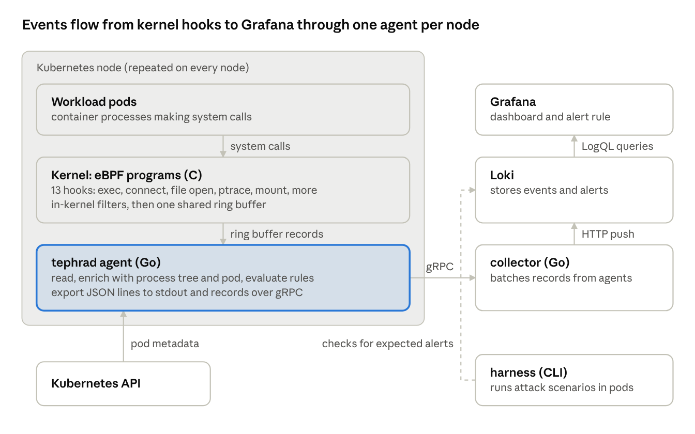

# Tephra: Kubernetes Runtime Threat-Detection Sensor — Engineering Design

Nov 10, 2026 · @nk

## 1. Summary and locked decisions

The project is a Linux runtime security sensor for Kubernetes nodes: eBPF programs observe process, file, network and privilege activity in the kernel, a Go agent attributes each event to a pod and evaluates detection rules, and alerts land in Grafana. A scripted attack harness proves what it detects and what it misses.

It runs as one privileged DaemonSet pod per node. Version 1 detects only. Version 2 adds in-kernel blocking through LSM hooks.

This document is the build spec. Every milestone in section 10 has an acceptance test, and nothing outside this document is in scope without a change here first.

| # | Decision | Choice | Reason |
|---|---|---|---|
| 1 | Kernel side | C, libbpf-style, CO-RE | Largest body of reference code; same approach as Tetragon and Cilium |
| 2 | Userspace agent | Go with cilium/ebpf and bpf2go | Existing Go experience; first-class Kubernetes client libraries |
| 3 | v1 scope | Detect only; blocking is v2 | A showable result earlier; enforcement is designed in section 9 but built last |
| 4 | Dev and test environment | Local VM running a kind cluster; EKS only for the final demo | Attack tests never touch the laptop host; AWS spend stays at a few dollars |
| 5 | Build mode | Spec-driven from this document; design owned by Naved | The doc carries hook lists, struct layouts, map definitions and interfaces |
| 6 | Event pipeline | JSON lines plus gRPC to a Go collector, stored in Loki, viewed in Grafana | No custom UI; a stack security teams already operate |
| 7 | Rule format | Own YAML schema with Sigma-style field names and ATT&CK tags | Full control over which predicates are pushed into the kernel |
| 8 | Repository and licence | Public; kernel programs GPL-2.0, agent and everything else Apache-2.0 | Recruiters can read it; most BPF helpers require a GPL-compatible program licence |
| 9 | Schedule | No dates; milestones ordered by dependency | Chosen explicitly |

The project is named Tephra. The repo and Helm chart are tephra, and the agent binary is tephrad. Where this document says "the sensor", it means Tephra.

## 2. Goals, non-goals and threat model

### Goals

- Detect the post-exploitation techniques listed in section 6 on a Kubernetes node, with each alert naming the pod, container, image and process ancestry.
- Prove coverage with a repeatable attack harness that produces a detected / missed table mapped to MITRE ATT&CK.
- Measure overhead against Falco and Tetragon on the same workloads and publish the numbers, including the unfavourable ones.
- Run on any x86-64 kernel 5.15 or newer with BTF, without compiling on the node.
- In v2, block a small set of high-confidence actions synchronously in the kernel.

### Non-goals

- Windows, macOS or arm64 support.
- Kernels older than 5.15 or without BTF. No kernel-module fallback.
- A custom web UI, multi-tenant backend or long-term storage design.
- Malware scanning, file hashing against threat feeds, or network payload inspection.
- Detecting attacks that happen entirely inside the Kubernetes API (RBAC abuse, malicious admission). The sensor sees nodes, not the API server audit log.
- Being a product. No installer, licensing server or support matrix.

### Threat model

The attacker has code execution inside a container, through an application vulnerability or a malicious image, and is trying to do one of five things: get an interactive shell, steal credentials, persist, move to the host, or use the node's resources.

| Attacker position | In scope | Notes |
|---|---|---|
| Unprivileged process in a container | Yes | Primary case |
| Root in an unprivileged container | Yes | Primary case |
| Root in a privileged or hostPID container | Yes, detect the escape | The escape itself is the detection target |
| Root on the host | Partly | Sensor can be killed or its programs detached; tamper events are emitted but not guaranteed |
| Kernel code execution (malicious module, kernel exploit) | No | An attacker in the kernel can blind any eBPF sensor; only the module load is detectable |

### Trust boundaries

- Everything read from user memory at a syscall entry is attacker-controlled and can change after the sensor reads it. Section 9 covers why this matters for blocking.
- Kernel structures read at LSM hooks and scheduler tracepoints (task_struct, linux_binprm, struct file) are trusted.
- The agent trusts the kubelet and the container runtime on its own node, and nothing from inside workload containers.

## 3. Architecture

Four components run per cluster: eBPF programs and the agent on every node, and one collector feeding Loki and Grafana. Only the agent talks to the kernel, and only the collector talks to Loki.



Read it bottom-up on the left and bottom-up on the right: the kernel feeds the agent, the agent feeds the collector, and the dashed line is the harness checking Loki for the alerts its attacks should have produced.

### Components

| Component | Runs as | Language | Responsibility |
|---|---|---|---|
| eBPF programs | In the kernel, loaded by the agent | C | Capture events at hooks, apply in-kernel filters, write to the ring buffer |
| tephrad agent | DaemonSet pod, one per node | Go | Load programs, read events, build the process tree, attribute to pods, evaluate rules, export |
| collector | Deployment, 1 replica | Go | Receive gRPC streams from agents, batch, push to Loki |
| Loki + Grafana | Helm sub-charts | — | Store events and alerts, dashboards, alert rules |
| harness | CLI run from the dev machine | Go + shell | Run attack scenarios, query Loki, write the coverage report |

### Path of one event

1. A process in a pod calls execve. The sched_process_exec tracepoint fires in the kernel.
2. The eBPF program checks the per-event-type enable flag and the in-kernel filters. If the event passes, it fills an exec_event and submits it to the ring buffer.
3. The agent's reader goroutine decodes the bytes into a Go struct and hands it to the enrichment stage.
4. Enrichment looks up the process in the process tree, and resolves its cgroup ID to container ID, pod, namespace and image.
5. The rule engine evaluates every rule subscribed to exec events. A match produces an alert that embeds the full event.
6. The exporter writes the event and any alert as JSON lines to stdout and streams them over gRPC to the collector.
7. The collector batches by label set and pushes to Loki. Grafana shows the alert within the dashboard refresh interval.

### Repository layout

```
tephra/
  bpf/                    # GPL-2.0
    vmlinux.h             # generated by bpftool, committed per arch
    common.h              # event header, shared maps, helper macros
    exec.bpf.c  net.bpf.c  file.bpf.c  priv.bpf.c  tamper.bpf.c
    lsm.bpf.c             # v2 enforcement
  cmd/
    tephrad/              # agent entrypoint
    collector/            # gRPC -> Loki
    harness/              # attack runner + coverage report
  hack/                   # acceptance-test scripts
  internal/
    loader/               # bpf2go output, attach, kernel feature probes
    events/               # Go mirrors of C structs, decoder
    proctree/             # process cache
    k8s/                  # cgroup -> container -> pod
    enrich/               # ancestry, user and pod attribution per event
    rules/                # YAML parser, compiler, evaluator
    export/               # stdout, gRPC client
  api/                    # protobuf definitions
  rules/                  # shipped detection rules (YAML)
  attacks/                # one directory per scenario
  deploy/
    docker/               # image build files
    helm/tephra/          # DaemonSet, collector, RBAC, sub-charts
    kind/                 # lab cluster definition
    terraform/eks-demo/   # throwaway EKS cluster
    vm/                   # dev VM definition
  bench/                  # workloads and result parser
  docs/                   # this design, coverage report, evasion write-ups
  LICENSES/               # GPL-2.0 and Apache-2.0 texts, SPDX headers per file
```

### Interfaces between components

- Kernel to agent: one BPF_MAP_TYPE_RINGBUF carrying variable-length records that all start with the common header in section 4. Config flows the other way through BPF maps the agent writes.
- Agent to collector: a client-streaming gRPC call Export(stream Record) returns (Ack), where Record wraps either an event or an alert as protobuf. mTLS is out of scope for v1; the service is cluster-internal.
- Collector to Loki: HTTP push to /loki/api/v1/push.
- Agent to Kubernetes: a pod informer filtered to spec.nodeName == <this node>, read-only.

## 4. Kernel sensor

The kernel side is thirteen small programs that each attach to one hook, fill one event struct and submit it to a shared ring buffer. Hooks are chosen so that every field read comes from kernel memory, not from user pointers.

### Hook list

| Event type | Hook | Program type | What is read | Milestone |
|---|---|---|---|---|
| exec | sched_process_exec | tp_btf | Binary path, inode, argv from mm->arg_start, stdio fd types, creds | M1 |
| fork | sched_process_fork | tp_btf | Parent and child pid, start time | M1 |
| exit | sched_process_exit | tp_btf | Pid, exit code | M1 |
| connect | security_socket_connect | fentry | Family, destination address and port (or Unix socket path) from the kernel copy of sockaddr | M3 |
| accept | inet_csk_accept | fexit | Local and peer address from the returned struct sock | M3 |
| file_open | security_file_open | fentry | Path via bpf_d_path, open flags, inode | M3 |
| ptrace | security_ptrace_access_check | fentry | Target pid, mode (only PTRACE_MODE_ATTACH is emitted) | M8 |
| memfd | sys_enter_memfd_create | tracepoint | Flags only; the name pointer is not trusted | M8 |
| module_load | module:module_load | tracepoint | Module name | M8 |
| bpf_load | security_bpf | fentry | Command (only BPF_PROG_LOAD), program type | M8 |
| cred_change | commit_creds | fentry | Old and new uid, gid and effective capabilities | M8 |
| mount / setns | security_sb_mount, sys_enter_setns | fentry, tracepoint | Filesystem type, flags, target path; namespace type | M8 |

Reasons behind the less obvious choices:

- sched_process_exec instead of sys_enter_execve. The syscall-entry tracepoint fires before the kernel has resolved anything, so the path and argv are user pointers that can be rewritten by another thread. The scheduler tracepoint fires after the exec has succeeded and exposes struct linux_binprm.
- security_* functions with fentry in v1. They are the same call sites the LSM programs use in v2, so the v2 change is mostly a program-type switch plus a return value. fentry needs kernel 5.5 or newer on x86-64 and is cheaper than a kprobe.
- fexit on inet_csk_accept. Only the return value is read, because the function's argument list has changed across kernel versions.
- commit_creds is not a stable interface. It is the one hook most likely to need a fallback; the loader treats attach failure here as a warning, not an error.

### Common event header

Every record starts with this header. The agent switches on type and uses size to decode the rest.

```
struct event_hdr {
    __u64 ts_boot_ns;      // bpf_ktime_get_boot_ns()
    __u64 start_time_ns;   // task->start_boottime: (pid, start_time) is the process key
    __u64 cgroup_id;       // bpf_get_current_cgroup_id(), cgroup v2
    __u32 type;            // enum event_type
    __u32 size;            // total record size in bytes
    __u32 pid;             // tgid in the node's pid namespace (the root one on a real node)
    __u32 tid;
    __u32 ppid;
    __u32 uid;
    __u32 gid;
    __u32 pid_ns;          // inode number of the pid namespace
    __u32 mnt_ns;          // inode number of the mount namespace
    __u32 flags;           // per-type flag bits
    char  comm[16];
};
```

### Event payloads

```
struct exec_event {
    struct event_hdr h;
    __u64 inode;
    __u32 dev;
    __u32 argv_len;        // bytes used in argv, NUL-separated
    __u64 cap_effective;
    char  path[256];       // bprm->interp; bpf_d_path is not callable from this hook
    char  argv[1024];      // truncated; EXEC_F_ARGV_TRUNC set in h.flags
};
// h.flags: EXEC_F_STDIN_SOCK, EXEC_F_STDOUT_SOCK, EXEC_F_UNLINKED (i_nlink == 0),
//          EXEC_F_SETUID, EXEC_F_ARGV_TRUNC

struct net_event {         // connect and accept
    struct event_hdr h;
    __u16 family;          // AF_INET or AF_INET6
    __u16 lport;
    __u16 rport;
    __u16 proto;
    __u8  laddr[16];
    __u8  raddr[16];
};

struct file_event {
    struct event_hdr h;
    __u64 inode;
    __u32 open_flags;
    __u32 watch_bits;      // value of the matching path_watch entry
    char  path[256];
};
```

A connect to an AF_UNIX socket is emitted as a separate unix_connect record: the header plus sun_path[108] from the kernel copy of the address. R010 matches on it.

The remaining payloads (ptrace, memfd, module_load, bpf_load, cred_change, mount, setns) are small fixed structs defined when M8 starts; each is the header plus the fields named in the hook table.

The two socket flags on exec are the basis of reverse-shell detection: the program reads file descriptors 0 and 1 from task->files->fdt and checks whether each inode is a socket.

### BPF maps

| Map | Type | Key and value | Written by | Purpose |
|---|---|---|---|---|
| events | RINGBUF, 16 MiB default | — | Kernel | All events to userspace |
| scratch | PERCPU_ARRAY, 1 entry | index, largest event struct | Kernel | Build events that exceed the 512-byte BPF stack |
| cfg | ARRAY, 1 entry | index, struct tephra_cfg | Agent | Enabled event bitmask, agent tgid |
| stats | PERCPU_ARRAY | event type, {seen, filtered, emitted, dropped} | Kernel | Per-hook counters, exported as metrics |
| path_watch | LPM_TRIE | {prefixlen, path[128]}, watch bits | Agent | Path prefixes that file_open should emit |
| cgroup_ignore | HASH | cgroup ID, 1 byte | Agent | Skip the sensor's own pod and other trusted cgroups |
| net_ignore_v4, net_ignore_v6 | LPM_TRIE | CIDR, 1 byte | Agent | Destinations never emitted (loopback, node-local) |

### In-kernel filtering

Filtering in the kernel is what keeps overhead low, because the expensive part of an event is copying it to userspace.

- Each program first checks its bit in cfg.enabled and returns if clear.
- It then looks up the current cgroup ID in cgroup_ignore.
- file_open resolves the path into scratch, then does one path_watch lookup. No match means no event. This is the only way file monitoring is affordable; unfiltered opens are the highest-volume event on any node.
- connect and accept check the remote address against the ignore tries.
- Events are built in scratch and sent with bpf_ringbuf_output using the actual length, so a short argv does not consume 1.3 KiB of ring space. The cost is one extra copy compared with bpf_ringbuf_reserve.
- If the ring buffer is full, the program increments stats.dropped for its type and returns. Drops are never silent: the agent exports the counter and the coverage report prints it.

File watching also matches by identity. A second map, inode_watch (HASH, key {dev, inode}, value watch bits), is checked before path_watch, so a watched file opened through a hard link or an unexpected path is still emitted. The agent fills it by resolving each exact-file rule path to its inode: on the host at start-up, and inside each container when the container starts, through /proc/<pid>/root. Prefix rules for directories stay path-based.

### Portability and kernel requirements

Programs are compiled once with CO-RE. vmlinux.h is generated with bpftool btf dump and field access goes through BPF_CORE_READ, so offsets are relocated on the target kernel at load time from /sys/kernel/btf/vmlinux.

| Requirement | Needed for | Available since |
|---|---|---|
| CONFIG_DEBUG_INFO_BTF=y | CO-RE relocation | Distribution-dependent; present on current Ubuntu, Fedora, Arch and Amazon Linux 2023 kernels |
| fentry / fexit | Most hooks | 5.5 (x86-64) |
| BPF ring buffer | Event transport | 5.8 |
| bpf_ktime_get_boot_ns | Timestamps that survive suspend | 5.8 |
| CAP_BPF, CAP_PERFMON | Running without full CAP_SYS_ADMIN | 5.8 |
| bpf_d_path | File and exec paths | 5.10 |
| BPF LSM, with bpf in the active LSM list | v2 blocking only | 5.7 |

The supported floor is 5.15 LTS. At start-up the loader probes each feature and logs a table of what attached; a missing optional hook disables its event type instead of failing the agent.

Every .bpf.c file declares char LICENSE[] SEC("license") = "GPL"; and carries an SPDX-License-Identifier: GPL-2.0 header.

### Verifier constraints to design around

- 512-byte stack: all large structs live in scratch.
- Every loop needs a compile-time bound. Argv is read as one bpf_probe_read_user of min(arg_end - arg_start, 1024) bytes, not an argument-by-argument loop.
- Every pointer read from a kernel struct must go through a CO-RE read helper; direct dereference is only allowed on tp_btf and fentry arguments.
- Variable lengths passed to helpers must be masked so the verifier can prove the bound (len &= sizeof(buf) - 1).

## 5. Userspace agent (tephrad)

The agent is one Go binary structured as a pipeline of four stages connected by bounded channels: read, enrich, evaluate, export. A slow stage applies backpressure up to the ring buffer, where drops are counted instead of hidden.

### Loader

- bpf2go compiles each .bpf.c at build time and embeds the object in the Go binary, so the container image needs no compiler.
- On start: raise RLIMIT_MEMLOCK, probe kernel features, load the collection, write cfg and the filter maps, then attach programs one by one.
- Links are held open by the agent and not pinned. If the agent exits, the kernel detaches everything; nothing is left behind on the node. The v2 enforcement programs are the exception and are pinned by default (section 9).
- The agent writes its own cgroup ID into cgroup_ignore before attaching, so it never reports itself.

### Ring buffer reader

- One goroutine blocks on ringbuf.Reader.Read(), decodes the header, and dispatches on type to a typed decoder. Decoding uses fixed offsets generated from the C structs, with a test that fails the build if a Go struct size differs from the C one.
- Boot-time timestamps are converted to wall-clock once at start-up by sampling both clocks.
- The agent exposes per-type seen, filtered, emitted and dropped on a Prometheus /metrics endpoint, reading the stats map on each scrape.

### Process tree

Rules need ancestry ("a shell whose parent is nginx"), which a single event does not carry.

- Key: (pid, start_time_ns). A pid alone is reused by the kernel; the pair is unique for the uptime of the node.
- Entry: binary path, argv, uid, cgroup ID, parent key, container metadata once resolved, exit time.
- Populated from fork, exec and exit events. At start-up the agent walks /proc once to seed processes that were already running.
- Entries are removed 60 seconds after exit so that late events from other hooks still resolve. The cache is capped (default 65,536 entries) with oldest-exited eviction.
- Ordering: all hooks write to one ring buffer, which hands records to the agent in the order they were produced, so a fork always precedes its exec. An event whose process or parent is unknown therefore predates the agent, and is read from /proc on the spot instead of being held.
- Re-parenting: when a process's recorded parent has exited, its current parent is read from /proc and the link is updated. Container runtimes rely on this on every start (runc forks the first process and exits, leaving it to the shim).

### Pod attribution

The kernel knows cgroups; Kubernetes knows pods. The agent joins them in three steps.

- cgroup ID to cgroup path. On first sight of a cgroup ID, walk the host cgroup filesystem under /sys/fs/cgroup and match the directory whose inode number equals the ID. Cache the result.
- cgroup path to container ID. The last path segment contains the runtime's container ID, for containerd in the form cri-containerd-<64 hex>.scope. Extract it with a pattern per runtime; containerd is the only one supported in v1.
- Container ID to pod. A pod informer scoped to this node keeps an index from status.containerStatuses[].containerID to pod name, namespace, labels, container name and image.

Events from cgroups with no container ID are labelled as host processes (`k8s.namespace: host`). An event whose cgroup cannot be resolved at all, or whose container is not known to Kubernetes, is labelled `unknown` so that it is never mistaken for a host process. cgroup v2 is required; nodes on cgroup v1 are rejected at start-up with a clear message.

A container's first processes run before its status reaches the API server. Until it does, the pod is resolved through the pod UID in the cgroup path, and the event carries namespace, pod and labels but no container name or image.

In kind, each node is itself a container, so pod cgroups are nested under the node container's cgroup on the VM. The path-matching step must handle that extra prefix, and the M2 acceptance test runs on kind for exactly this reason.

kind has a second consequence. All its nodes share one kernel, so every agent's programs see every node's processes, and the pids the kernel reports in the root namespace are not the pids the node's /proc shows. At start-up the agent runs a small program in its own context to learn its pid namespace (depth and inode) and its cgroup. The kernel programs then report pids as numbered in that namespace and drop tasks outside it. On a real node the namespace is the root one and nothing is dropped.

### Enriched event (wire format)

The JSON line and the protobuf message carry the same fields. Field names follow Sigma conventions where one exists.

```
{
  "ts": "2026-11-10T08:22:31.004512Z",
  "type": "exec",
  "node": "kind-worker",
  "process": {
    "pid": 48211, "start_time_ns": 91822330114,
    "Image": "/bin/sh", "CommandLine": "sh -i",
    "User": "www-data", "uid": 33,
    "stdin_is_socket": true, "stdout_is_socket": true
  },
  "parent": { "pid": 48190, "Image": "/usr/sbin/nginx", "CommandLine": "nginx: worker process" },
  "ancestors": ["/usr/sbin/nginx", "/usr/bin/containerd-shim-runc-v2"],
  "container": { "id": "3f9c…", "name": "web", "image": "nginx:1.27" },
  "k8s": { "namespace": "shop", "pod": "web-7c9d8-xk2lp", "labels": { "app": "web" } }
}
```

An alert is the same object wrapped with rule.id, rule.title, rule.level and rule.tags.

### Export

- stdout: always on. One JSON object per line, so kubectl logs works with no backend.
- gRPC: optional, enabled when a collector address is configured. A bounded queue (default 8,192 records) sits in front of the stream; when it is full, raw events are dropped before alerts and the drop is counted.
- Reconnect uses exponential backoff from 1 to 30 seconds.

### Configuration

One YAML file mounted from a ConfigMap, reloaded on SIGHUP: enabled event types, ring buffer size, ignore lists, rules directory, collector address, whether raw events are exported or only alerts.

## 6. Rule engine

Rules are YAML files that the agent compiles at start-up into two things: entries in kernel filter maps, and an in-memory matcher that runs on enriched events. A rule never needs code changes to add.

### Rule schema

```
id: R001
title: Shell with a network socket as stdin and stdout
level: high                      # info | low | medium | high | critical
tags: [attack.execution, attack.t1059.004]
event: exec                      # exactly one event type per rule
detection:
  selection:
    process.Image|endswith: [/sh, /bash, /dash, /zsh, /ash]
    process.stdin_is_socket: true
    process.stdout_is_socket: true
  filter:
    k8s.namespace: kube-system
  condition: selection and not filter
action: alert                    # v2 adds: block
description: An interactive shell wired to a socket is the shape of a reverse or bind shell.
falsepositives:
  - Remote-exec tooling that attaches shells over raw sockets
```

### Semantics

- Fields are dotted paths into the enriched event from section 5.
- Modifiers after |: equals (default), startswith, endswith, contains, in, cidr, re, gt, lt. A list value means any-of.
- Named blocks (selection, filter, or any name) are AND across their fields. condition combines block names with and, or, not and parentheses.
- Ancestry: ancestors|contains matches against the list of ancestor binary paths, which is how "spawned somewhere under a web server" is expressed.
- One event type per rule. Correlation across events (sequence, count over time) is not part of the first rule engine and arrives in M13: a rule can then require an ordered sequence of single-event matches from the same process tree or pod inside a time window.

### Compilation

| Rule content | Compiled to | Effect |
|---|---|---|
| event: across all loaded rules | Bits in cfg.enabled | Hooks no rule uses are never emitted |
| `file.path\|startswith` on a `file_open` rule | An entry in path_watch | |
| file.path with any other modifier | Rejected at load with an error | Prevents a rule that silently needs every file open on the node |
| Everything else | Userspace matcher tree | Evaluated per event, rules indexed by event type |

The loader validates every rule (unknown field, wrong type for a modifier, bad ATT&CK tag format) and refuses to start on an invalid file. tephrad rules test <rule> <events.jsonl> runs rules against recorded events offline, which is what the unit tests use.

### Initial rule set

| ID | Detection | Event | ATT&CK | Level |
|---|---|---|---|---|
| R001 | Shell with socket stdin and stdout | exec | T1059.004 | High |
| R002 | Shell spawned under a network-facing server process | exec | T1059.004 | Medium |
| R003 | Execution of a memfd or already-unlinked binary | exec | T1620 | High |
| R004 | Download or package tool run in a container (curl, wget, apt, apk) | exec | T1105 | Low |
| R005 | /etc/shadow opened by a process outside an allowlist | file_open | T1003.008 | High |
| R006 | Service account token read by a process other than the pod's main binary | file_open | T1528 | Medium |
| R007 | Write to /etc/ld.so.preload | file_open | T1574.006 | High |
| R008 | Write under a cron directory | file_open | T1053.003 | Medium |
| R009 | Write to an authorized_keys file | file_open | T1098.004 | High |
| R010 | Connection to the container runtime's Unix socket from inside a container | connect | T1611 | Critical |
| R011 | Write to a cgroup release_agent or to core_pattern | file_open | T1611 | Critical |
| R012 | Shell history truncated or removed | file_open | T1070.003 | Low |
| R013 | Connection to the Kubernetes API from an unexpected binary | connect | T1613 | Medium |
| R014 | Outbound connection to common mining-pool ports | connect | T1496 | Low |
| R015 | ptrace attach to another process | ptrace | T1055.008 | High |
| R016 | Kernel module loaded while a container process is current | module_load | T1547.006 | Critical |
| R017 | mount called from inside a container | mount | T1611 | High |
| R018 | setns into a host namespace | setns | T1611 | Critical |
| R019 | uid changes to 0 with no setuid binary executed | cred_change | T1068 | Critical |
| R020 | BPF program loaded by anything other than the sensor | bpf_load | T1562.001 | High |

R001 to R014 use only M1 and M3 hooks and form the first rule milestone. R015 to R020 arrive with the M8 hooks.

R021, added after the first draft: exec in a container with LD_PRELOAD, LD_AUDIT or LD_LIBRARY_PATH set (T1574.006, medium). The exec program scans the environment block between mm->env_start and mm->env_end and copies only variables whose names are on a fixed allowlist into the event. Nothing else from the environment leaves the kernel. Scenario A18 sets LD_PRELOAD on a process in a pod and expects R021.

## 7. Backend and deployment

Everything installs with one Helm chart: the agent DaemonSet, the collector, and Loki and Grafana as optional sub-charts. The same chart is used on kind and on EKS, with one values file per environment.

### Collector

- Accepts the Export stream from every agent, validates records, and groups them by Loki label set.
- Flushes a batch at 1 MiB or 1 second, whichever comes first, and retries failed pushes with backoff. A bounded in-memory queue protects it; overflow is counted and exposed on /metrics.
- Stateless. One replica in v1; scaling out only needs a Service in front.

### Loki label design

Loki indexes labels, not content, so labels must stay low-cardinality. Pod name, pid and rule ID stay inside the JSON body and are filtered at query time with | json.

| Label | Values | Why it is a label |
|---|---|---|
| cluster | One per cluster | Separates kind from EKS data |
| node | One per node | Sensor health per node |
| namespace | Kubernetes namespace, or host | The most common filter |
| stream | event or alert | Lets alerts be retained longer than raw events |
| type | Event type | Per-hook volume panels |
| level | Alert level; absent on raw events | Alert rules key on it |

### Grafana

One provisioned dashboard, shipped as JSON in the chart:

- Alerts over time, stacked by level.
- Top rules and top pods by alert count.
- Latest alerts table with pod, process, parent and command line.
- Sensor health: events per second per type, ring buffer drops, export queue depth, collector push errors.

One Grafana alert rule fires on any high or critical alert and posts to a configurable webhook.

### Agent DaemonSet

| Setting | Value | Reason |
|---|---|---|
| hostPID | true | Read /proc for the start-up process scan |
| Capabilities | BPF, PERFMON, SYS_RESOURCE, SYS_PTRACE | Load and attach programs, raise memlock, read other processes' /proc entries |
| privileged | true until M6, then replaced by the capability list | The narrowed list must be proven to work, not assumed |
| Host mounts, read-only | /proc, /sys/fs/cgroup, /sys/kernel/btf, /sys/kernel/tracing, /sys/kernel/security | Process scan, cgroup resolution, CO-RE, tracepoint IDs, LSM list |
| RBAC | get, list, watch on pods | Pod informer only |
| Tolerations | All taints | The sensor must run on every node, including control-plane nodes |
| Resources | Requests 100m CPU and 128 MiB; limit 512 MiB | Starting point, revised from benchmark results |
| Update strategy | Rolling, maxUnavailable: 1 | A node is unmonitored only while its pod restarts |

The agent image is a static Go binary on a distroless base. Rules are mounted from a ConfigMap generated from the rules/ directory.

### Development environment

- A QEMU/libvirt virtual machine on the Arch laptop: Ubuntu Server LTS, 4 vCPUs, 8 GiB RAM. All attack scenarios run inside this VM and nowhere else. The VM runs in the unprivileged libvirt session (`qemu:///session`) with passt networking, so operating it needs no root on the laptop; SSH is forwarded to 127.0.0.1:2222.
- Inside it, kind with one control-plane node and two workers, using containerd and dual-stack networking so IPv4 and IPv6 paths are both exercised.
- make dev builds the images, loads them with kind load docker-image, and runs helm upgrade --install.
- For v2, check cat /sys/kernel/security/lsm in the VM. If bpf is missing, add it to the lsm= kernel command-line parameter and reboot.

### Continuous integration

GitHub Actions on every push: C and Go lint, bpf2go build, Go unit tests, rule validation, then a kind end-to-end job that installs the chart and runs two harness scenarios. A failed detection fails the build.

### EKS demo

A self-contained Terraform module creates a cluster for one recorded session and is destroyed afterwards.

- VPC with public subnets only, so there is no NAT gateway charge.
- EKS control plane plus one managed node group of two t3.medium nodes on Amazon Linux 2023.
- helm install with values-eks.yaml, run the full harness, record the Grafana dashboard, terraform destroy.
- Approximate cost: the control plane is billed at $0.10 per hour and each node at roughly $0.04 to $0.05 per hour, so a four-hour session is on the order of $1. Check current pricing before running.

Before the session, confirm two things on the node AMI: the kernel version, and whether bpf is in the active LSM list. The second decides whether v2 blocking can be shown on EKS or only on kind.

## 8. Attack harness, coverage report and benchmarks

The harness is what turns the sensor from a claim into evidence: it runs each technique in the lab cluster, checks whether the expected alert arrived, and writes a table of detected and missed. It only ever targets the lab VM or the throwaway EKS cluster.

### How a scenario is defined

Each scenario is a directory under attacks/:

```
attacks/A01-reverse-shell/
  scenario.yaml     # id, title, ATT&CK tags, expected rule IDs, timeout, target pod spec
  target.yaml       # the victim workload (and any attacker-side listener pod)
  run.sh            # the technique, executed inside the target with kubectl exec
  cleanup.sh
```

### How a run works

1. Create a fresh namespace and apply target.yaml. Wait for readiness.
2. Record the start time, run run.sh, record the end time.
3. Query Loki for alerts in that window, namespace and pod.
4. Verdict per expected rule: detected (alert present with the right pod and process), partial (alert present, attribution wrong or incomplete), missed.
5. Record detection latency (alert timestamp minus action timestamp) and the ring buffer drop counter delta.
6. Run cleanup.sh and delete the namespace.

harness run --all writes docs/coverage.md and coverage.json. The Markdown report is committed with the sensor version and kernel version it was produced on.

### Detection scenarios

| ID | Scenario | Expected rules |
|---|---|---|
| A01 | Reverse shell from a web server pod to a listener pod | R001, R002 |
| A02 | Run a harmless binary from a memfd with no file on disk | R003 |
| A03 | Download a tool into a running container and execute it | R004 |
| A04 | Read /etc/shadow from a non-system process | R005 |
| A05 | Read the service account token, then query the Kubernetes API | R006, R013 |
| A06 | Write an entry to /etc/ld.so.preload | R007 |
| A07 | Add a cron entry | R008 |
| A08 | Append a key to authorized_keys | R009 |
| A09 | Open the containerd socket through a hostPath mount | R010 |
| A10 | Write a cgroup release_agent from a privileged pod | R011 |
| A11 | Truncate shell history | R012 |
| A12 | Connect to a lab listener on a mining-pool port | R014 |
| A13 | ptrace attach to a neighbouring process | R015 |
| A14 | Load a benign kernel module from a privileged pod | R016 |
| A15 | Mount the host root filesystem from a privileged pod | R017 |
| A16 | Enter host namespaces with nsenter from a hostPID pod | R018 |
| A17 | Load a BPF program with a second tool | R020 |

R019 (uid changes to 0 with no setuid exec) has no live scenario, because reproducing it needs a kernel exploit. It is covered by a unit test with a synthetic event, and the coverage report says so.

### Evasion scenarios

These exist to find the limits. Several are expected to be missed in v1, and the write-ups explain why and what would close each gap.

| ID | Evasion | Expected v1 result | What it demonstrates |
|---|---|---|---|
| E01 | Copy the shell to a random name before the reverse shell | R001 missed | Matching on binary path is weak; inode or hash identity is stronger |
| E02 | Interactive session implemented inside an interpreter, no shell exec | Missed | Exec-based detection cannot see in-process behaviour |
| E03 | Open a watched file through a hard link under an unwatched path | Detected | Path-prefix filters versus inode-based watching |
| E04 | Open a watched file through io_uring | Detected | LSM-layer hooks see operations that syscall tracing does not |
| E05 | Flood the ring buffer with benign events, then act | Detected or drop reported | Drop accounting and buffer sizing |
| E06 | Race a syscall argument after entry | Detected | Why the sensor avoids user-pointer reads |
| E07 | Kill the agent, act, let it restart | Missed, gap visible | Tamper visibility and why enforcement must live in the kernel |
| E08 | argv longer than the capture limit with the payload at the end | Partial | Truncation flag and its effect on rules |

### False-positive run

Run ordinary workloads for 30 minutes with all rules enabled: an nginx deployment under HTTP load, a PostgreSQL pod under pgbench, an image build job, and a rolling update. The target is zero high or critical alerts. Every alert that does fire is either fixed in the rule or documented under falsepositives.

### Benchmarks

The question is what the sensor costs a node compared with running nothing, Falco, or Tetragon.

| Dimension | Values |
|---|---|
| Configurations | No sensor; this sensor exporting all events; this sensor exporting alerts only; Falco with its modern eBPF probe and default rules; Tetragon with default tracing |
| Workloads | Exec-heavy (tight fork and exec loop); file-heavy (untar and compile a source tree); network-heavy (HTTP load against nginx); idle |
| Measured | Workload throughput and p99 latency relative to no sensor; agent CPU and resident memory; events per second; ring buffer drops |
| Method | Same VM and kernel, CPUs pinned, five runs per cell, report median with minimum and maximum |

Results go in docs/benchmarks.md with the raw data and the scripts under bench/. The numbers come from a laptop VM and are comparable only to each other, which the report states at the top.

## 9. Version 2: enforcement

Version 2 lets a rule deny an action in the kernel before it completes, using BPF LSM programs at the same call sites v1 observes. It ships off by default, starts in dry-run, and covers a deliberately small set of actions.

### Why blocking has to happen at LSM hooks

A sensor that decides at syscall entry reads its evidence from user memory: the path for openat, the address for connect. The kernel reads that same memory again a moment later to do the real work. A second thread can change the bytes between the two reads, so the sensor approves one path and the kernel opens another. This is a time-of-check to time-of-use race, and it makes syscall-entry enforcement bypassable by design.

LSM hooks run after the kernel has copied and resolved its arguments. The program sees the struct file, struct linux_binprm or kernel sockaddr that will actually be used, and its return value is the decision: 0 allows, a negative errno denies.

### Mechanism

| Action to deny | LSM hook | Program section |
|---|---|---|
| Executing a binary | bprm_check_security | lsm/bprm_check_security |
| Opening a file | file_open | lsm/file_open |
| Connecting a socket | socket_connect | lsm/socket_connect |
| Attaching with ptrace | ptrace_access_check | lsm/ptrace_access_check |
| Mounting | sb_mount | lsm/sb_mount |
| Loading a kernel module | kernel_read_file, kernel_load_data | lsm/kernel_read_file, lsm/kernel_load_data |

Rules for every LSM program:

- If the incoming ret argument is already non-zero, return it unchanged. Another LSM has denied the action and that decision stands.
- Check cfg.enforce first. When it is 0 the program returns 0 immediately.
- Emit an event for every deny and every would-deny, with h.flags marking which.
- Return -EPERM only when a policy map lookup says so. No policy logic lives in userspace on this path.

Requirements: CONFIG_BPF_LSM=y and bpf present in the active LSM list. Where either is missing, the loader logs that enforcement is unavailable and the sensor keeps running in detect-only mode.

### Policy maps

| Map | Type | Meaning |
|---|---|---|
| deny_path | LPM_TRIE | Path prefix to deny bits (read, write, exec) |
| deny_flags | ARRAY | Per-hook switches: deny memfd exec, deny ptrace attach, deny mount, deny module load |
| enforce_cgroups | HASH | cgroup IDs where enforcement applies |
| protect_cgroups | HASH | cgroup IDs that are never denied anything |

A rule opts in with action: block. The compiler accepts block only on rules whose whole condition can be expressed in these maps; anything needing ancestry or regular expressions is rejected with an explanation, because that information does not exist in the kernel at decision time.

### First blockable set

| Rule | Deny |
|---|---|
| R003 | Exec of a memfd or unlinked binary inside a container |
| R007 | Write to /etc/ld.so.preload |
| R011 | Write to a cgroup release_agent or core_pattern from a container |
| R015 | ptrace attach inside a container |
| R016 | Module load while a container process is current |
| R017 | mount from a container not on an allowlist |

### Safety design

A blocking bug on a node can stop workloads or the node itself, so the defaults are conservative.

- Containers only. Enforcement applies to cgroups in enforce_cgroups, which the agent fills from pods carrying an opt-in label. Host processes are never denied.
- Protected cgroups. The kubelet, the container runtime and the sensor are written to protect_cgroups at start-up.
- Dry-run first. A rule with action: block runs as would-deny until enforce: true is set in the config. The harness has a mode that asserts would-deny events before any real deny is enabled.
- Kill switch. Setting cfg.enforce to 0 disables every deny in one map write, without unloading anything.
- Fail closed by default, configurable. The setting enforcement.onAgentExit takes pinned or detach, and the default is pinned. In pinned mode the LSM program links and policy maps are pinned under /sys/fs/bpf/tephra, so denies keep applying while the agent is down or being killed, and a restarted agent re-adopts the pins instead of reloading. This closes the blocking half of E07; events are still lost while the agent is down. The cost is that a wrong deny also survives an agent restart, so recovery must not depend on the agent: the pinned kill switch can be cleared with bpftool from the host, and removing the pin directory detaches everything. In detach mode nothing is pinned and enforcement stops when the agent exits. Strict is the v2 default, on the principle that enforcement which an attacker can switch off by killing a process is not enforcement; the trade-off goes in the write-up.

### Fallback where BPF LSM is unavailable

On kernels without BPF LSM, the fentry programs can call bpf_send_signal(SIGKILL) on the offending process. This is weaker: the signal is handled when the task returns towards user mode, so the triggering operation may already have completed. It is offered as an explicitly labelled kill action, separate from block, and is optional work after M11.

### What v2 must prove

- Each blockable scenario fails with a permission error inside the container and produces a deny event.
- The false-positive workloads from section 8 run with enforcement on and see zero denies.
- The benchmark table gains an "enforcement on" configuration.

## 10. Milestones

Fourteen milestones in dependency order, with no dates. M7 is the first version worth showing to an employer; M12 completes the design.

A milestone is done when its acceptance test passes in CI or is recorded in docs/, the README reflects the new capability, and this document is updated if the build diverged from it.

| # | Milestone | Delivers | Acceptance test | Needs |
|---|---|---|---|---|
| M0 | Skeleton and dev environment | VM definition, kind config, repo layout, Makefile, CI, one trivial program that loads | On a clean VM, make dev ends with the agent pod logging that its program attached | — |
| M1 | Process events | exec, fork, exit programs, ring buffer, decoder, JSON on stdout, stats | ls -la /tmp in a pod gives exactly one exec event with correct path, argv and uid within 1 second; after a 10,000-exec loop, emitted + dropped + filtered == seen; Go and C struct sizes match | M0 |
| M2 | Process tree and pod attribution | proctree, cgroup resolver, pod informer, /proc seeding | A pod's exec event carries namespace, pod, container, image and an ancestor chain; a host process is labelled host; after an agent restart, events from long-running processes still resolve | M1 |
| M3 | Network and file events | connect, accept, file_open, filter maps | curl from a pod gives a connect event with the right destination; opening a watched path gives one event; opening an unwatched path gives none and increments filtered; the file-heavy workload shows zero drops | M1 |
| M4 | Rule engine | YAML parser, compiler, matcher, rules test, R001 to R014 | Every rule has one matching and one non-matching recorded event in tests; an invalid rule stops start-up with file and line; SIGHUP reload takes effect without restart | M2, M3 |
| M5 | Backend | Protobuf API, gRPC export, collector, Loki, Grafana dashboard | An alert appears on the dashboard within 5 seconds of the action; restarting the collector loses nothing beyond the counted queue overflow | M4 |
| M6 | Packaging | Helm chart, capability-only security context, CI end-to-end job | helm install on a clean kind cluster works with privileged: false; CI runs two scenarios green | M5 |
| M7 | Harness and first coverage report | harness CLI, scenarios A01 to A12, false-positive run, coverage.md | harness run --all reports A01 to A12 detected; the false-positive run has zero high or critical alerts | M6 |
| M8 | Remaining hooks | ptrace, memfd, module_load, bpf_load, cred_change, mount, setns; R015 to R020; A13 to A17 | A13 to A17 detected; R019 passes its synthetic test; a hook that fails to attach disables only its own event type | M7 |
| M9 | Evasion work | Scenarios E01 to E08 and one write-up per finding | Each scenario's result matches or corrects the table in section 8, and each miss has a written explanation and a proposed fix | M8 |
| M10 | Benchmarks | bench/ workloads, result parser, benchmarks.md | All configurations and workloads measured five times; raw data committed | M7 |
| M11 | EKS demo | Terraform module, values-eks.yaml, recorded run | Full harness passes on EKS; cluster destroyed; recording and cost noted in the README | M8 |
| M12 | Enforcement (v2) | LSM programs, policy maps, action: block, dry-run, kill switch | Each blockable scenario is denied with a permission error and a deny event; the false-positive workloads see zero denies; benchmark table extended | M8 |

M9, M10, M11 and M12 are independent of each other once M8 is done and can be taken in any order.

M13, correlation rules (needs M8): a sequence block in the rule schema, per-process-tree and per-pod state with a bounded window and memory cap, and two shipped rules (download then execute the downloaded file; service account token read then Kubernetes API connection). Acceptance: both rules fire on A03 and A05, neither fires in the false-positive run, and state memory stays under its cap in the exec-heavy benchmark.

Two additions to earlier milestones follow from the decisions in section 11: M3 includes inode_watch and IPv6 connect and accept tests, and M4 includes the environment allowlist and R021.

## 11. Risks, open questions and references

### Risks

| Risk | Effect | Mitigation |
|---|---|---|
| Verifier rejects a program that looks correct | Days lost per hook | One small program per hook; load tests in CI on the 5.15 floor and on a current kernel |
| A hooked function changes between kernels (commit_creds, inet_csk_accept) | Hook fails to attach on some nodes | Loader treats these as optional; feature table logged at start-up; M8 acceptance covers it |
| bpf_d_path is not usable from a chosen hook | No path on exec or file_open | bpf_d_path only works from an allowlist of attach points (`btf_allowlist_d_path` in kernel/trace/bpf_trace.c). security_file_open is on it in 5.10 through 7.0; sched_process_exec is not, so the exec path will need the bprm->filename fallback. Confirm both in M1 and M3 |
| Event volume exceeds the ring buffer on busy nodes | Dropped events, missed detections | In-kernel filters first, drop counters always exported, buffer size configurable, benchmark includes drops |
| kind cgroup nesting differs from a real node | Pod attribution works locally and fails on EKS, or the reverse | M2 runs on kind; M11 reruns the whole harness on EKS |
| BPF LSM not active on the EKS node image | v2 cannot be shown on EKS | Check before the session; show enforcement on kind if needed |
| Kernel version numbers in section 4 could be wrong | A stated minimum could be off by a release | Checked in M0 against the kernel source tags on either side of each stated version; all six entries were correct. The loader's feature probe remains the authority |
| The author cannot explain a design choice in an interview | The project counts against him instead of for him | Evasion write-ups and a decisions log in docs/ are written by Naved; every hook choice in section 4 has its reason recorded |
| Scope growth (custom UI, correlation engine, more runtimes) | No finished release | Non-goals in section 2; changes go through this document |
| Attack scenarios run outside the lab | Harm to a real system | Harness refuses to run unless the cluster carries a lab label; README states lab-only use |

### Decisions on former open questions

Each was settled in favour of the stronger security outcome.

| Question | Decision | Why it is the stronger option | Where it lands |
|---|---|---|---|
| Project name | Tephra | — | Whole document |
| Raw events or alerts only | Export every raw event by default | An investigation needs what happened before and after an alert, and a rule added later can be run over past events | Section 5 export; alerts and raw events get separate Loki retention |
| Cross-event correlation | In scope, as M13 | Single-event rules miss attacks whose individual steps look normal | Sections 6 and 10 |
| Environment capture on exec | Capture an allowlist of variable names only | Makes LD_PRELOAD injection detectable; the full environment is never captured because it routinely holds secrets, and copying those into logs would create a new exposure | Section 6, rule R021 |
| File watching by inode | Yes, in addition to path prefixes | A hard link under another path shares the inode, so E03 is closed | Section 4, inode_watch |
| IPv6 | In scope from the first coverage report | An IPv4-only sensor leaves a full network path unwatched | Section 7, dual-stack kind |

### References

- Linux kernel BPF documentation and its LSM BPF programs page.
- BPF CO-RE reference guide by Andrii Nakryiko.
- ebpf-go documentation for cilium/ebpf and bpf2go.
- Tetragon and Falco source, as reference implementations and benchmark baselines.
- MITRE ATT&CK Containers matrix.
- Sigma rule specification for field naming and modifiers.

## 12. Build log

Where the build diverged from the text above, by milestone. The sections above are edited in place; this log records what changed and why.

### M0

- **Dev VM session.** The VM is defined under `qemu:///session` with passt networking instead of a system libvirt network (section 7).
- **Repository layout.** Added `deploy/kind/`, `deploy/docker/` and `hack/` (section 3). Directories for later milestones are created when their milestone starts.
- **Trivial program.** The M0 program is the real exec hook (`tp_btf/sched_process_exec`) reduced to incrementing its `stats` counter, so M1 extends it.
- **Compiler flag.** The BPF programs are compiled with `-fms-extensions`. `vmlinux.h` generated from a 7.2 kernel embeds tagged structs anonymously, which standard C rejects.
- **Kernel version table.** Section 4 verified against kernel sources; no corrections were needed (section 11, risks).
- **bpf_d_path.** Not callable from `sched_process_exec`; recorded in the risk table for M1.
- **Compilation table, section 6.** The Effect cell of the `file.path|startswith` row was lost in the original document and is left blank.

### M1

- **Pids are node-relative.** `event_hdr.pid`, `tid` and `ppid` are numbered in the agent's pid namespace, and tasks outside it are filtered in the kernel (sections 4 and 5). Without this, kind reports each event three times and no pid matches /proc. Adds `tephra_cfg.pidns_level` and `pidns_inum`, a `self` map, and the `tephra_self` program (type `syscall`, needs kernel 5.14).
- **Exec path.** `exec_event.path` is `bprm->interp`, not the `bprm->filename` fallback the risk table names. The two are the same for an ordinary exec. For a `#!` script, `filename` is the script and `interp` is the interpreter that actually runs, so with `interp` a shell started through a script still has a shell as its `Image` and R001 and R002 cannot be sidestepped by wrapping the shell in a script. The script's path remains in argv. `inode`, `dev` and the unlinked and setuid flags come from `mm->exe_file`, also the interpreter, so path and identity now describe the same file. The path is still the name as executed: relative if the caller used a relative path.
- **Fork and exit payloads** (left open in section 4). `fork_event`: header of the forking task, then `child_pid`, `parent_pid`, `child_start_time_ns`, `parent_start_time_ns`. `exit_event`: `exit_code` as a wait status. Thread creation and non-final thread exits are counted as filtered.
- **Wire format additions.** `process` also carries `gid`, `cgroup_id`, and on exec `unlinked`, `setuid`, `argv_truncated`, `inode`, `dev`, `cap_effective`. Exit events carry `exit: {code, signal}`. For a fork, `process` is the child.
- **Logs.** Events go to stdout and the agent's own log to stderr, so the event stream stays one JSON event per line.
- **Metrics** are read from the stats map per scrape instead of every 10 seconds.
- **Not built yet:** the YAML config file and SIGHUP reload from section 5; the agent takes flags. They are needed first by M4.
- **Kernel floor tested.** The programs, compiled on the laptop against a 7.2 `vmlinux.h`, load unchanged on Ubuntu 22.04's 5.15.0-203 kernel: the privileged load tests and the M0 to M2 acceptance tests pass there with zero drops. This is a distribution 5.15, not a vanilla one. It is a manual run (see the README), not part of CI, which runs on the GitHub runner kernel.

### M2

- **No 100 ms hold** for unknown processes; they are read from /proc immediately (section 5, process tree).
- **Re-parenting** is followed through /proc (section 5, process tree).
- **/proc start times are tick-precise.** A seeded process is keyed by its start time rounded to 10 ms and matched to kernel events by pid and tick.
- **`unknown` namespace label** and the pod-UID fallback (section 5, pod attribution).
- **`User`** is resolved from the passwd file in the process's own mount namespace, through /proc/<pid>/root, and omitted when the uid has no entry.
- **New package** `internal/enrich` (section 3).
- **RBAC:** the chart now grants get, list and watch on pods, cluster-wide; the informer itself is filtered to the agent's node.
